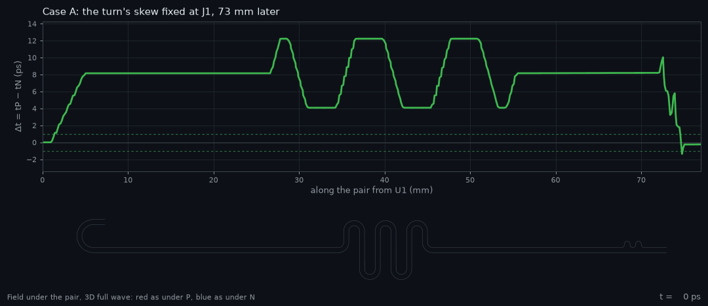
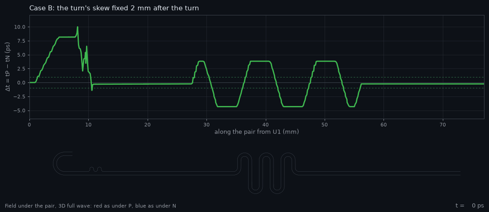
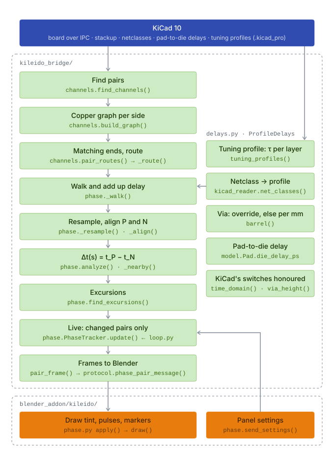

# Dynamic phase

KiCad 10 matches a differential pair by its total delay, end to end [1]. A pair can match there and still run out of phase in between. For example, a bend near one end that is only compensated at the far end leaves P and N apart in time over everything between. Where they are apart, part of the differential signal turns into common mode, which radiates and picks up noise [2], [3]. Correcting the skew at the far end doesn't undo that.

Dynamic phase shows how far P and N are apart in time **at every point along the pair**, live while you route in KiCad. It uses KiCad's own delay numbers, so its end-to-end skew is KiCad's; what it adds is where along the pair the skew is made and undone.

**Fig. 1.** Δt along a demo pair (0.2 mm traces, 0.25 mm apart, 0.12 mm over εr 4.1) while a 25 ps pulse travels from U1 to J1: case A above, case B below. Both start with the same U-turn, which makes 8.1 ps of length difference. A fixes it with two bumps at J1, 73 mm later; B fixes it 3 mm after the turn. In A, P runs about 9 ps behind N for 73 mm; in B only the serpentine's own swings remain. The line in these animations comes from an earlier version of the tool that added the turn's full-wave share to Δt (8.9 ps at the turn). The tool now reads 8.1 ps there and puts the share in a note on the turn ([Notes](#notes-where-kicads-number-is-off)). The cursor follows the pulse. Under each chart is the field under the pair from a 3D full-wave simulation (openEMS [4]), red under P and blue under N. Dashed lines: the ±1 ps marker tolerance.

## What you see

- **Tint:** P red, N blue, over each trace. The stronger the colour, the further apart P and N are there. Via lands are tinted too.
- **Pulses:** start together at the start end and travel at each trace's own delay, slowed down. The pulse in front is ahead.
- **Via light:** columns in the via barrels, in the colour of the side.
- **Amber markers:** where |Δt| stays above your tolerance for longer than your minimum length.
- **Pink markers:** where P's copper touches N's, a short. A shorted pair has no phase and no numbers. Its pulses run from the start end up to the short and stop there.
- **Cyan markers:** copper that closes a loop with the route, such as an old route left beside a new one. The pair is measured along the shortest path. The loop's copper is listed, and a click selects it in KiCad.
- **Pair list:** every pair with its total delay, end-to-end skew and largest |Δt|, a warning icon when it has an excursion or a loop, and SHORT for a shorted pair.
- **Notes**, in the selected pair's box: each place where KiCad's one delay per layer is known to be off, with how much to add to Δt there. A click selects the copper in KiCad. See [Notes](#notes-where-kicads-number-is-off).

> [!WARNING]
> The pulses are a timing indicator only. They are not electric or magnetic (E/H) fields, currents or voltages. A pulse reaches each point of a trace at the delay dynamic phase computes for it, slowed down from picoseconds to seconds. Nothing else about it is physical. Its shape, width, brightness, tail and glow are chosen to be easy to see. No field, rise time, reflection, loss, crosstalk or radiation is simulated, and a pulse stopping at a short is not what a signal does there.

The tool measures and shows. It doesn't judge: there are no interface standards or pass/fail, only the two thresholds you set for the markers.

## The Δt chart

**Export chart (SVG)** under the pair list writes one small plot per pair: Δt along the pair, the marker tolerance as a green band, every excursion shaded orange with its peak, and over each plot the pair's ends, its end-to-end skew and its largest |Δt|. All plots share one scale, so the pairs compare at a glance. A source and its compensation read as a plateau: Δt steps up at the bend and only steps back where the compensating bump sits, and the plateau's width is how far apart they are. The numbers, the pairs' notes included, go into the SVG's `<metadata>` block. Unless you untick it in the file dialog, a `.csv` with one row per point (pair, mm along the pair, Δt in ps) is written beside it.

## From the DRC column

The DRC column's **Dynamic phase** button measures every pair at once and lists what the pair list marks, as findings of their own next to KiCad's DRC:

| Finding | Severity |
|---|---|
| Short | error |
| Excursion (the stretch's copper is lit, with a label at its start) | warning |
| Loop | warning |
| Unfinished side, branch, ends on different parts, note | info |

They get the DRC column's markers on the board, confirm and dismiss, and a click selects the copper in KiCad. The file is `.kileidoscope/<board>.phase.kls-findings.json`, beside the DRC one. It is a snapshot: press the button again after routing.

## How it is calculated

<picture>
  <source media="(prefers-color-scheme: dark)" srcset="../assets/dynamic-phase-dark.svg">
  
</picture>

**Fig. 2.** How dynamic phase is calculated. Green runs in the bridge, orange in the Blender add-on.

Each step with its code and what it assumes:

**1. Find pairs** · [`channels.find_channels()`](../kileido_bridge/channels.py)
Nets are paired by KiCad's differential-pair naming (`_P`/`_N`, `+`/`-`). A 2-pad part joining pair nets on both sides, such as AC-coupling caps, chains them into one channel: `TX_P → C1 → TX_C_P` with `TX_N → C2 → TX_C_N`. Can be turned off with *Through series parts*.
*Assumes:* series parts have exactly two pads. A pair joined to more than two others is not chained.

**2. Copper graph per side** · [`channels.build_graph()`](../kileido_bridge/channels.py)
Track and arc ends are nodes. An end landing inside another track splits that track there, as KiCad connects a T. Vias and pads are nodes that touching ends connect to; stacked vias and vias in pads are joined.
*Assumes:* two pieces touch when an end lies within half a track width. Zones (pours) don't join the route.

**3. Matching ends, route** · [`channels.pair_routes()`](../kileido_bridge/channels.py)
The possible ends are pads with a single connection. Of the parts both sides reach, the two farthest apart over P and N together become the pair's ends, so both sides always end on the same parts. Each side's route is the shortest copper path between them. Any other end (an ESD diode, a second receiver) is a branch: listed and warned about, but not walked.
*Assumes:* a branch's loading and reflections don't count. Where a side has a loop, the shorter path is used.

**4. Walk and add up delay** · [`phase._walk()`](../kileido_bridge/phase.py)
Each side is walked from the start end. Every track piece adds its length times the unit delay τ of its layer, the delay of a uniform transmission line [5], [3] (see [Delay model](#delay-model)). A via adds its barrel between the two layers it connects, and a pad or series part adds the straight line between where the tracks meet it:

$$t(s) = \sum_{\text{pieces up to } s} \ell_i \, \tau_i \tag{1}$$

*Assumes:* delay doesn't depend on frequency, and there is no loss. A capacitor counts only as the distance across it.

**5. Resample, align P and N** · [`phase._resample()`, `_align()`](../kileido_bridge/phase.py)
Both sides are sampled evenly along their copper, at most 400 points and at least 0.05 mm apart. Dynamic time warping [6] then matches the two sample sequences by 3D distance, counting only the distance beyond each point's nearest point on the other side. Running side by side costs nothing at any pitch, and where one side meanders, the other side's position waits.
*Assumes:* where P and N split far apart (breakouts to different pins), points are matched only by being near each other, and Δt there means less.

**6. Δt along the pair** · [`phase.analyze()`, `_nearby()`](../kileido_bridge/phase.py)
Each matched point is projected onto the partner's copper, so the result doesn't depend on the sampling step. Δt is the delay difference gathered from the start up to that point, the intra-pair skew [3] taken at every point instead of only at the ends:

$$\Delta t(s) = t_P(s) - t_N(s') \tag{2}$$

with $s'$ the matched point on N. Δt < 0: P's edge is ahead there; Δt > 0: N's is.
*Assumes:* a direction; see [Which end to start from](#which-end-to-start-from).

**7. Excursions and notes** · [`phase.find_excursions()`, `_notes()`](../kileido_bridge/phase.py)
Wherever |Δt| stays above *Marker above (ps)* for at least *Marker longer than (mm)*, a marker at the start of that stretch, with its peak Δt. Defaults: 1 ps over 5 mm. Each coupled turn, bump and tight meander the walk finds gets a note when one delay per layer is known to be off there (see [Notes](#notes-where-kicads-number-is-off)).

**8. Live: changed pairs only** · [`phase.PhaseTracker`](../kileido_bridge/phase.py)
A pair is recomputed only when its copper, the delay inputs (stackup, project file, netclasses) or the settings change. Each poll spends at most 80 ms; pairs left over follow on the next polls.

**9. Frames to Blender** · [`phase.pair_frame()`](../kileido_bridge/phase.py), [`protocol.phase_pair_message()`](../kileido_bridge/protocol.py)
For each side: its path, and at every point the delay from the start, the lead over the partner and the track width. Plus via lands, both ends, excursions, notes, branches, delay sources and warnings. Blender draws them in [`blender_addon/kileido/phase.py`](../blender_addon/kileido/phase.py).

## Delay model

The unit delay τ (ps/mm) of each piece comes from [`delays.py`](../kileido_bridge/delays.py): one number per layer, charged to every track of the net, as KiCad's own time-domain tuning does [1]. The first source that applies wins, and the pair box names which one was used.

| Source | Unit delay | Used when |
|---|---|---|
| KiCad tuning profile | the profile's ps/mm for that layer, as it is; vias by override, or ps/mm × height | the net's netclass has a tuning profile (Board Setup › Tuning Profiles) |
| Microstrip estimate | $\tau = \sqrt{\varepsilon_\text{eff}}\,/\,c$ [5], with Hammerstad and Jensen's static $\varepsilon_\text{eff}(w/h)$ of a lone trace [7] | outer layers without a profile, with εr from the board's stackup |
| Stripline estimate | $\tau = \sqrt{\varepsilon_r}\,/\,c$ [5] | inner layers without a profile, with εr from the board's stackup |
| FR-4 default | εr = 4.2 in the formulas above | the stackup gives no dielectric constant |

Here $1/c$ = 3.3356 ps/mm, $w$ is the track width and $h$ the dielectric thickness to the next copper layer. For stripline, different dielectrics above and below are averaged by thickness. A via barrel without a profile is $\sqrt{\varepsilon_r}/c$ times the height between the two layers it connects, with εr of the dielectrics it passes.

The estimates are there so a board without tuning profiles still shows something. For numbers that match KiCad's, give the pair's netclass a tuning profile; the panel says when a pair has none.

### Why Δt holds up when τ is off

Δt is a difference between P and N. Where both run on the same layer at the same width, they get the same τ, so an error in τ doesn't create Δt; it only scales it. A τ that is 2.5 % off makes a 2 ps excursion read 1.95 or 2.05 ps. The absolute delays of P and N carry the full error; Δt mostly doesn't.

Δt does go wrong where P and N really differ at the same place in a way one number per layer doesn't see. The notes cover the cases that were measured.

## Notes: where KiCad's number is off

One delay per layer is exact for a straight, uniform pair. A full-wave study (openEMS [4], one pair geometry: 0.2 mm traces, 0.25 mm apart, 0.12 mm over εr 4.1) found three features where the real skew differs from what the length rule gives. Dynamic phase doesn't correct Δt for them. It puts a note on each such feature with the Δt the feature made and what to add:

$$\Delta t_\text{add} = k \cdot \Delta t_\text{made} \tag{3}$$

Add it to Δt after the feature and to the end-to-end skew. Δt_made is the change in Δt over the feature's own stretch.

| Feature | k | Status | Noted when |
|---|---|---|---|
| Coupled turn: P and N turn together | +8.5 % | openEMS: +8.5 % (arc of 1.25 mm radius), +8.8 % (2.5 mm), +7.7 % (four 45° corners) | on an outer layer, both on one layer, outside any bump or meander |
| P and N apart: a bump, a breakout, the straight beside a partner's bump | +3 % | openEMS: a straight lone trace runs 3.2 % slower than the coupled pair (zero-thickness copper; 4.3 % with 35 µm copper) | on an outer layer, with a tuning profile (KiCad computes its number for the coupled pair; the stackup estimate is a lone trace's already) |
| Tight meander: a corner radius or leg spacing under 3 track widths | −17 % | openEMS: two rounded bumps (corner radius 1.25 widths, legs 1.5 widths apart) made 16.9 % less than KiCad's number gives | on any layer |

A note shows only when what it adds is 0.1 ps or more. A turn and the same turn back give two notes that cancel. So do a tight bump and its compensation, but the excursion between them is then about 17 % smaller than Δt shows.

The shares come from one pair geometry. A more tightly coupled pair probably makes more turn skew than +8.5 %; that is not checked. A looser meander (corners and legs 3 widths or more) was run once, as a single shallow bump: it made about 0.8 ps more skew than the tool's earlier, corrected model gave it, and why is not known. It gets only the "apart" note.

## Assumptions and what isn't modelled

- **One delay per layer.** Coupling between P and N, a pour beside the pair and the pair's width changes don't change τ. The notes cover the measured exceptions.
- **No frequency dependence.** One εr per dielectric, as the stackup gives it. No change of Dk with frequency, no microstrip dispersion, no loss, no skin effect. These affect P and N alike where they run together.
- **Microstrip estimate:** no solder mask (delay a few % too low), zero copper thickness, and the next copper layer is assumed to be the reference plane. A tuning profile replaces all of this with KiCad's number.
- **No plane underneath** (a plain coplanar waveguide, a 2-layer board without a pour on the other side, a plane several layers down) is not detected.
- **Vias** are treated as a piece of line. Pad and antipad capacitance and the via stub are ignored.
- **Branches** (ESD stubs, second receivers) are shown but their loading isn't modelled.
- **Glass-weave skew** (one trace over glass, the other over resin) can't be predicted from the layout.

## When not to trust it

- P and N with a plane edge (a split) under them, or no plane under them at all.
- Long stretches where P and N run far apart; Δt there is defined only by which points are nearest.
- Unfinished routes: the pair list warns when a side isn't fully routed.
- Pairs whose sides still end on different parts: the pair list warns.
- Delays from "FR-4 default" or a stackup estimate: set a tuning profile in KiCad for KiCad's numbers.

## Which end to start from

Δt is gathered from the start end. Walked from the other end, it becomes, by (2),

$$\Delta t'(s) = \text{skew} - \Delta t(s) \tag{4}$$

with skew the total delay difference of the pair. The two views are the same only when total skew is 0. Start from the driver: *Flip start* in the pair list walks a pair from its other end. For a pair driven from both ends (USB, for example) both views matter.

## Validation

The synthetic boards in [`tests/phase_boards.py`](../tests/phase_boards.py) are checked in [`tests/test_phase.py`](../tests/test_phase.py), and drawn headless in Blender by [`tests/blender/run_phase.py`](../tests/blender/run_phase.py).

| Board | What the test checks |
|---|---|
| Matched pair | no skew, no Δt, no excursions, no notes; delay = length × τ |
| Mismatch compensated at the far end | an excursion is found although total skew is 0; a tight-meander note on each bump |
| Mismatch compensated close by | no excursion |
| Layer change through vias | each barrel adds its height between the two layers |
| AC-coupling caps | both pairs join into one channel; length includes the hop across each cap |
| ESD diode on stubs | the stub is a branch, not an end; the route length excludes it |
| Second receiver on stubs | P and N both end on U1 and J1, even where N alone would pick the receiver |
| Flipped start | Δt from the other end equals total skew − Δt |
| Unfinished route | reported |
| Arcs | count their true length, not their chords |
| Tuning profile | its number for every track of the net, a bump included, as KiCad does; vias by override or per mm |
| Coupled turn | Δt is the length difference; a note adds 8.5 % of it; an S has two notes that cancel; none on stripline |
| Bumps | a tight bump gets a tight-meander note; a looser one none without a profile, an "apart" note with one; a bump right after a turn leaves the turn's note alone |
| Lone trace, full wave | the microstrip estimate against a 3D FDTD run (openEMS [4], not part of the repository) of a 0.2 mm trace alone over 0.12 mm of εr 4.1: 5.865 against 5.876 ps/mm (0.2 %); one mesh, 8 cells per dielectric height |
| Findings file | an excursion, a short, a loop, a branch, an unfinished side and a note become findings the findings reader takes whole, every target found on the board |
| Chart | every pair on one scale, the excursions shaded, the numbers and notes in the SVG, Δt in the CSV |
| No εr in the stackup | FR-4 is used and named as the source |
| Microstrip vs stripline | microstrip is faster |
| Stackup from the board file | εr is read from the `.kicad_pcb` text |
| Live tracker | recomputes only changed pairs, spreads work over polls, follows Blender's settings |

**Still to do:** compare the end-to-end delays with KiCad's own time-domain tuning on a real board with a tuning profile. By construction they should be equal.

## References

[1] KiCad Developers, "PCB Editor: Length tuning," in *KiCad 10.0 Documentation*. [Online]. Available: https://docs.kicad.org/10.0/en/pcbnew/pcbnew.html. Accessed: Oct. 16, 2026.

[2] S. H. Hall and H. L. Heck, *Advanced Signal Integrity for High-Speed Digital Designs*. Hoboken, NJ, USA: Wiley, 2009.

[3] E. Bogatin, *Signal and Power Integrity—Simplified*, 3rd ed. Boston, MA, USA: Pearson, 2018.

[4] T. Liebig, A. Rennings, S. Held, and D. Erni, "openEMS – a free and open source equivalent-circuit (EC) FDTD simulation platform supporting cylindrical coordinates suitable for the analysis of traveling wave MRI applications," *Int. J. Numer. Model.: Electron. Netw., Devices Fields*, vol. 26, no. 6, pp. 680–696, Nov. 2013, doi: 10.1002/jnm.1875.

[5] D. M. Pozar, *Microwave Engineering*, 4th ed. Hoboken, NJ, USA: Wiley, 2012.

[6] H. Sakoe and S. Chiba, "Dynamic programming algorithm optimization for spoken word recognition," *IEEE Trans. Acoust., Speech, Signal Process.*, vol. 26, no. 1, pp. 43–49, Feb. 1978.

[7] E. Hammerstad and Ø. Jensen, "Accurate models for microstrip computer-aided design," in *IEEE MTT-S Int. Microw. Symp. Dig.*, Washington, DC, USA, May 1980, pp. 407–409.

## Code

| File | Contents |
|---|---|
| [`kileido_bridge/channels.py`](../kileido_bridge/channels.py) | pairs, channels through series parts, copper graph, ends and routes |
| [`kileido_bridge/delays.py`](../kileido_bridge/delays.py) | delay model: tuning profiles, the microstrip and stripline estimates, vias |
| [`kileido_bridge/phase.py`](../kileido_bridge/phase.py) | walk, alignment, Δt, excursions, notes, live tracker, frames |
| [`kileido_bridge/phase_findings.py`](../kileido_bridge/phase_findings.py) | the DRC column's Dynamic phase button: every pair as a findings file |
| [`blender_addon/kileido/phase_chart.py`](../blender_addon/kileido/phase_chart.py) | the Δt chart: SVG and CSV |
| [`blender_addon/kileido/phase.py`](../blender_addon/kileido/phase.py) | drawing: tint, pulses, glow, via light, markers, labels |
| [`blender_addon/kileido/high_speed_panel.py`](../blender_addon/kileido/high_speed_panel.py) | the Diff pairs column: dynamic phase settings, pair list and notes |
