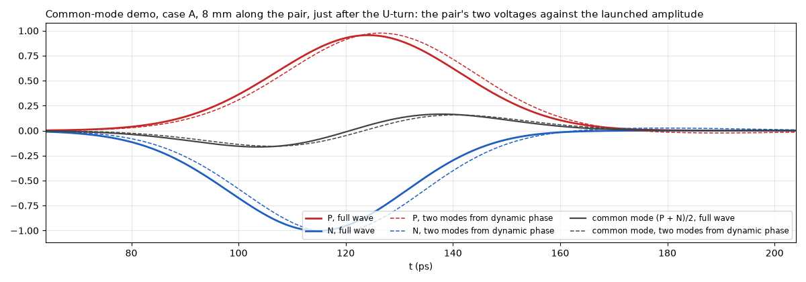
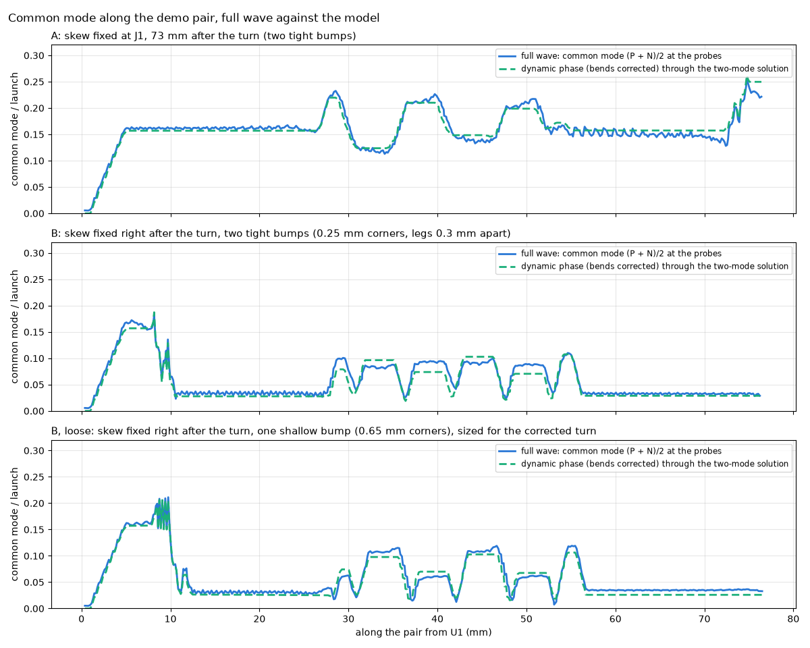

# Dynamic phase

KiCad 10 matches a differential pair by its total delay, end to end [1]. A pair can match there and still run out of phase in between. For example, a bend near one end that is only compensated at the far end leaves P and N apart in time over everything between. Where they are apart, part of the differential signal turns into common mode, which radiates and picks up noise [2], [3]. Correcting the skew at the far end doesn't undo that.

Dynamic phase shows how far P and N are apart in time **at every point along the pair**, live while you route in KiCad.

**Fig. 1.** Dynamic phase's Δt along a demo pair (0.2 mm traces, 0.25 mm apart, 0.12 mm over εr 4.1) while a 25 ps pulse travels from U1 to J1: case A above, case B below. Both start with the same U-turn, which leaves P 8.9 ps behind N: its 8.1 ps of length difference times 1 + κ, (12). A fixes it with two bumps at J1, 73 mm later; B fixes it 3 mm after the turn. The bumps make up the turn's length difference only, so both pairs end 0.4–0.5 ps from matched; in A P runs 9 ps behind for 73 mm, while in B only the serpentine's own swings remain. The cursor follows the pulse; under each chart is the field under the pair from a 3D full-wave simulation (openEMS [4]), red as under P and blue as under N. Dashed lines: the ±1 ps marker tolerance.

## What you see

- **Tint:** P red, N blue, over each trace. The stronger the colour, the further apart P and N are there. Via lands are tinted too.
- **Pulses:** start together at the start end and travel at each trace's own delay, slowed down. The pulse in front is ahead.
- **Via light:** columns in the via barrels, in the colour of the side.
- **Amber markers:** where |Δt| stays above your tolerance for longer than your minimum length.
- **Pink markers:** where P's copper touches N's, a short. A shorted pair has no phase and no numbers. Its pulses run from the start end up to the short and stop there.
- **Cyan markers:** copper that closes a loop with the route, such as an old route left beside a new one. The pair is measured along the shortest path. The loop's copper is listed, and a click selects it in KiCad.
- **Pair list:** every pair with its total delay, end-to-end skew and largest |Δt|, a warning icon when it has an excursion or a loop, and SHORT for a shorted pair.

> [!WARNING]
> The pulses are a timing indicator only. They are not electric or magnetic (E/H) fields, currents or voltages. A pulse reaches each point of a trace at the delay dynamic phase computes for it, slowed down from picoseconds to seconds. Nothing else about it is physical. Its shape, width, brightness, tail and glow are chosen to be easy to see. No field, rise time, reflection, loss, crosstalk or radiation is simulated, and a pulse stopping at a short is not what a signal does there.

The tool measures and shows. It doesn't judge: there are no interface standards or pass/fail, only the two thresholds you set for the markers.

## The Δt chart

**Export chart (SVG)** under the pair list writes one small plot per pair: Δt along the pair, dashed beside it Δt as a probe on each trace would read it (fading where the skew's common mode has fallen behind the edge, see [the drift](#the-equations-behind-it)), the marker tolerance as a green band, every excursion shaded orange with its peak, and over each plot the pair's ends, its end-to-end skew and its largest |Δt|. All plots share one scale, so the pairs compare at a glance. A source and its compensation read as a plateau: Δt steps up at the bend and only steps back where the compensating bump sits, and the plateau's width is how far apart they are. Where a side has a tight meander, a pale blue band along the Δt line shows the known model error there (see [Assumptions](#assumptions-and-what-isnt-modelled)): 10–20 % less skew than its extra length, applied to the Δt each meander made. Δt itself is not corrected there; coupled bends are, by (12). The numbers go into the SVG's `<metadata>` block and, unless you untick it in the file dialog, into a `.csv` beside it (pair, mm along the pair, Δt in ps as made and as read, and the band's two edges).

## From the DRC column

The DRC column's **Dynamic phase** button measures every pair at once and lists what the pair list marks, as findings of their own next to KiCad's DRC: an excursion is a warning with the stretch's copper lit and a label at its start, a short an error, a loop a warning; an unfinished side, a branch, or ends on different parts are info. They get the DRC column's markers on the board, confirm and dismiss, and a click selects the copper in KiCad. The file is `.kileidoscope/<board>.phase.kls-findings.json`, beside the DRC one, and it is a snapshot: press the button again after routing.

## How it is calculated

<picture>
  <source media="(prefers-color-scheme: dark)" srcset="../assets/dynamic-phase-dark.svg">
  
</picture>

**Fig. 2.** How dynamic phase is calculated. Green runs in the bridge, orange in the Blender add-on.

Each step with its code and what it assumes:

**1. Find pairs** · [`channels.find_channels()`](../kileido_bridge/channels.py)
Nets are paired by KiCad's differential-pair naming (`_P`/`_N`, `+`/`-`). A 2-pad part joining pair nets on both sides, such as AC-coupling caps, chains them into one channel: `TX_P → C1 → TX_C_P` with `TX_N → C2 → TX_C_N`. Can be turned off with *Through series parts*.
*Assumes:* series parts have exactly two pads. A pair joined to more than two others is not chained.

**2. Copper graph per side** · [`channels.build_graph()`](../kileido_bridge/channels.py)
Track and arc ends are nodes. An end landing inside another track splits that track there, as KiCad connects a T. Vias and pads are nodes that touching ends connect to; stacked vias and vias in pads are joined.
*Assumes:* two pieces touch when an end lies within half a track width. Zones (pours) don't join the route; they only change its speed (see Delay model).

**3. Matching ends, route** · [`channels.pair_routes()`](../kileido_bridge/channels.py)
The possible ends are pads with a single connection. Of the parts both sides reach, the two farthest apart over P and N together become the pair's ends, so both sides always end on the same parts. Each side's route is the shortest copper path between them. Any other end (an ESD diode, a second receiver) is a branch: listed and warned about, but not walked.
*Assumes:* a branch's loading and reflections don't count. Where a side has a loop, the shorter path is used without a warning.

**4. Walk and add up delay** · [`phase._walk()`](../kileido_bridge/phase.py)
Each side is walked from the start end. Every track piece adds its length times the unit delay τ of its layer, the delay of a uniform transmission line [5], [3] (see [Delay model](#delay-model)). A via adds its barrel between the two layers it connects, and a pad or series part adds the straight line between where the tracks meet it:

$$t(s) = \sum_{\text{pieces up to } s} \ell_i \, \tau_i \tag{1}$$

*Assumes:* delay doesn't depend on frequency, and there is no loss. A capacitor counts only as the distance across it.

**5. Resample, align P and N** · [`phase._resample()`, `_align()`](../kileido_bridge/phase.py)
Both sides are sampled evenly along their copper, at most 400 points and at least 0.05 mm apart. Dynamic time warping [6] then matches the two sample sequences by 3D distance, counting only the distance beyond each point's nearest point on the other side. Running side by side costs nothing at any pitch, and where one side meanders, the other side's position waits.
*Assumes:* where P and N split far apart (breakouts to different pins), points are matched only by being near each other, and Δt there means less.

**6. Δt along the pair** · [`phase.analyze()`, `_nearby()`](../kileido_bridge/phase.py)
Each matched point is projected onto the partner's copper, so the result doesn't depend on the sampling step. Δt is the delay difference gathered from the start up to that point, the intra-pair skew [3] taken at every point instead of only at the ends:

$$\Delta t(s) = t_P(s) - t_N(s') \tag{2}$$

with $s'$ the matched point on N. Δt < 0: P's edge is ahead there; Δt > 0: N's is.
*Assumes:* a direction; see [Which end to start from](#which-end-to-start-from).

**7. Excursions** · [`phase.find_excursions()`](../kileido_bridge/phase.py)
Wherever |Δt| stays above *Marker above (ps)* for at least *Marker longer than (mm)*, a marker at the start of that stretch, with its peak Δt and the [mode lag](#common-mode-and-mode-lag) over it. Defaults: 1 ps over 5 mm.

**8. Live: changed pairs only** · [`phase.PhaseTracker`](../kileido_bridge/phase.py)
A pair is recomputed only when its copper, the delay inputs (stackup, project file, netclasses) or the settings change. Each poll spends at most 80 ms; pairs left over follow on the next polls.

**9. Frames to Blender** · [`phase.pair_frame()`](../kileido_bridge/phase.py), [`protocol.phase_pair_message()`](../kileido_bridge/protocol.py)
For each side: its path, and at every point the delay from the start, the lead over the partner and the track width. Plus via lands, both ends, excursions, branches, delay sources and warnings. Blender draws them in [`blender_addon/kileido/phase.py`](../blender_addon/kileido/phase.py).

## Delay model

The unit delay τ (ps/mm) of each piece comes from [`delays.py`](../kileido_bridge/delays.py). The first source that applies wins, and the pair list names which one was used.

| Source | Unit delay | Used when |
|---|---|---|
| KiCad tuning profile | the profile's ps/mm for that layer, taken as the pair's at the entry's own width and gap; where the pair runs at another gap, one side alone, or beside a pour, scaled by the estimate's εeff ratio (below); vias by override, or ps/mm × height | the net's netclass has a tuning profile (Board Setup › Tuning Profiles) |
| Microstrip estimate | $\tau = \sqrt{\varepsilon_\text{eff}}\,/\,c$ [5], with $\varepsilon_\text{eff}$ of the coupled pair at the gap there | outer layers, with εr from the board's stackup |
| Stripline estimate | $\tau = \sqrt{\varepsilon_r}\,/\,c$ [5] | inner layers, with εr from the board's stackup |
| FR-4 default | εr = 4.2 in the formulas above | the stackup gives no dielectric constant |

Here $1/c$ = 3.3356 ps/mm. For microstrip, with $u = w/h$ (track width over the dielectric thickness to the next copper layer) and $g = s/h$ (the gap to the partner, edge to edge, measured every 50 µm along the route):

- a lone trace has Hammerstad and Jensen's static $\varepsilon_\text{eff}(u)$ [7];
- in a coupled pair the differential signal runs in the odd mode, with more of its field in the air between the two traces: Kirschning and Jansen's odd-mode $\varepsilon_\text{eff}(u, g)$ [8], which is lower and tends to the lone trace's as $g$ grows. So a stretch where one side meanders away or breaks out runs at the lone trace's speed.

On this project's MIPI pair (117 µm wide, 102 µm apart, 121 µm of εr 4.5) that gives 5.70 ps/mm, against 5.79 from KiCad's calculator [1] (a lone trace: 5.99).

With a tuning profile the profile's number is kept as the level and the estimate only supplies the change: KiCad's calculator worked the entry's delay out for the pair at the entry's width and gap, so that is where it holds exactly, and a stretch where P and N part is multiplied by $\sqrt{\varepsilon_\text{eff}(\text{gap there}) / \varepsilon_\text{eff}(\text{profile gap})}$, the ratio of the two unit delays $\tau = \sqrt{\varepsilon_\text{eff}}/c$ [5]. KiCad itself charges the one number to every track, which is why its pair tuning works only on coupled stretches and its docs send you to the single-track tuner for the rest [1]; here the two agree wherever the pair runs at the profile's gap, and a lone bump reads a few percent slower, as it is.

Beside a pour of another net on the same layer (a grounded coplanar waveguide), the trace runs faster again. A conformal mapping of the cross-section (Ghione and Naldi's method [9], with the pair's midline as an electric wall for the odd mode) gives $\varepsilon_\text{eff}$ with and without the pour; that ratio scales the value above. Against a 2D field solver (the repository's own, [`tests/field_solver.py`](../tests/field_solver.py)) it is within 1.5 %; a pour a quarter of a dielectric height away makes the MIPI pair about 3 % faster.

For stripline the field is entirely in the dielectric, so $\varepsilon_\text{eff} = \varepsilon_r$ whatever the width [5]; different dielectrics above and below are averaged by thickness. A via barrel is $\sqrt{\varepsilon_r}/c$ times the height between the two layers it connects, with εr of the dielectrics it passes.

**Coupled bends.** Where P and N turn together, the outer trace is longer by the pitch times the angle, and the length rule turns that into skew. The skew a coupled turn really makes is larger, by a share κ that follows from the pair's two modes, (12) below: about 0 for a loose pair, growing with the coupling. Dynamic phase multiplies the Δt each such step makes by 1 + κ at the gap there, with Kirschning and Jansen's even- and odd-mode impedances [8] for the impedance ratio, and gives half the correction to each side's delay. The demo pair gets κ = 9.3 %, where the full wave gave 7.7 to 8.8 %; this project's MIPI pair gets 25 %, which no full-wave run has checked. On stripline it is not applied: not checked there.

### Common mode and mode lag

A coupled pair carries two modes: the odd (differential) mode, whose field sits partly in the air between the traces, and the even (common) mode. On microstrip the even mode's effective permittivity is the higher, so it is the slower; in a homogeneous dielectric (stripline) the two travel at the same speed. Kirschning and Jansen's static even mode [8], with $u = w/h$ and $g = s/h$:

$$v = u\,\frac{20 + g^2}{10 + g^2} + g\,e^{-g}, \qquad \varepsilon_\text{eff,e} = \frac{\varepsilon_r + 1}{2} + \frac{\varepsilon_r - 1}{2}\left(1 + \frac{10}{v}\right)^{-a(v)\,b(\varepsilon_r)} \tag{3}$$

with $a$ and $b$ Hammerstad and Jensen's functions of the lone line [7], so that a pair far apart ($g \to \infty$, $v \to u$) has both modes become the lone line. The odd mode is the one in the delay model above. Each mode's unit delay is $\tau = \sqrt{\varepsilon_\text{eff}}\,/\,c$ [5], and the mode lag per mm is

$$\tau_\text{e} - \tau_\text{o} = \frac{\sqrt{\varepsilon_\text{eff,e}} - \sqrt{\varepsilon_\text{eff,o}}}{c}. \tag{4}$$

Skew turns differential signal into common mode [2], [3]. With P behind N by a small $\delta$, $V_P(t) = v(t - \delta)$ and $V_N(t) = -v(t)$, so to first order (derived below as (8))

$$V_\text{diff} = \frac{V_P - V_N}{2} \approx v\!\left(t - \tfrac{\delta}{2}\right), \qquad V_\text{cm} = \frac{V_P + V_N}{2} \approx -\frac{\delta}{2}\,\frac{dv}{dt} \tag{5}$$

a common-mode pulse shaped like the edge's derivative, of order $\delta / t_r$ of the differential amplitude for a rise time $t_r$. A compensating bump $L$ mm further on makes the opposite pulse, aligned with the differential edge as it is then; the first one has fallen behind by $(\tau_\text{e} - \tau_\text{o})\,L$, and the two cancel only while that lag is small against $t_r$. That is the mode lag dynamic phase reports for each excursion (the lag per mm at the gap there, added up along both sides of the stretch; 0 where a side runs alone and on stripline): compare it with your edge's rise time. On the common-mode demo's pair (0.2 mm traces, 0.25 mm apart, 0.12 mm over εr 4.1) the lag is about 0.33 ps/mm, so a fix 73 mm along the pair from the turn (case A, the serpentine included) comes 24 ps late for a 25 ps edge and leaves two common-mode pulses (the full-wave run's [4] two modes run 0.32–0.36 ps/mm apart, 23–26 ps over that stretch), while a fix 3 mm away (case B) cancels; the full-wave run gives a common-mode peak at J1 of 25 % of the differential one for A against 3.3 % for B (the two-mode solution from the model, coupled bends corrected: 27 % and 2.9 % at the last reading before J1). With a tuning profile the lag is in the profile's scale, as the delay is. Beside a pour the odd mode's ratio is applied to both modes; the pour's own effect on the even mode is not modelled.

### The equations behind it

Everything above follows from one standard result. For a symmetric coupled pair that is lossless, uniform along its length $z$ and terminated in its modal impedances (no reflections), the coupled telegrapher's equations separate into two modes that never exchange energy, the even (common) and the odd (differential), each with its own velocity $v = 1/\tau$, $\tau = \sqrt{\varepsilon_\text{eff}}/c$: Tripathi [10] for the general inhomogeneous case, Pozar [5] for the symmetric one, Hall and Heck [2] in the time domain. Whatever the two conductors carry at $z = 0$ arrives at $z$ as

$$V_P(z,t) = e\!\left(t - \tau_\text{e} z\right) + o\!\left(t - \tau_\text{o} z\right), \qquad V_N(z,t) = e\!\left(t - \tau_\text{e} z\right) - o\!\left(t - \tau_\text{o} z\right), \tag{6}$$

with $e(t) = \tfrac12\,[V_P(0,t) + V_N(0,t)]$ and $o(t) = \tfrac12\,[V_P(0,t) - V_N(0,t)]$. This is exact under those assumptions; (7)–(11) are algebra on it.

**Far-end crosstalk is the same velocity difference.** A step $s(t)$ on P with N quiet gives $e = o = s/2$, so by (6), at the far end of $\ell$ mm

$$V_N(\ell,t) = \tfrac12\,[\,s(t - \tau_\text{e}\ell) - s(t - \tau_\text{o}\ell)\,] \approx -\tfrac{\ell}{2}\,(\tau_\text{e} - \tau_\text{o})\,s'(t - \tau_\text{o}\ell), \tag{7}$$

the textbook far-end crosstalk of microstrip, zero on stripline where $\tau_\text{e} = \tau_\text{o}$ [2], [11]. The mode lag dynamic phase reports is $\ell\,(\tau_\text{e} - \tau_\text{o})$, the same quantity.

**Skew is mode conversion** [2]. P behind N by $\delta$ at $z = 0$, $V_P = s(t - \delta)$ and $V_N = -s(t)$, gives by the definitions under (6) and a Taylor expansion about $t - \delta/2$

$$e(t) = \tfrac12\,[\,s(t - \delta) - s(t)\,] = -\tfrac{\delta}{2}\,s'\!\left(t - \tfrac{\delta}{2}\right) + O(\delta^3), \qquad o(t) = \tfrac12\,[\,s(t - \delta) + s(t)\,] = s\!\left(t - \tfrac{\delta}{2}\right) + O(\delta^2). \tag{8}$$

In Bockelman and Eisenstadt's mixed-mode parameters [12] the same statement in the frequency domain is $S_\text{cd21} = \tfrac12\,(S_{21,P} - S_{21,N}) = \tfrac12\,e^{-j\omega T}\,(e^{-j\omega\delta} - 1)$ for two lines of delay $T$ and $T + \delta$, so

$$|S_\text{cd21}| = |\sin(\pi f \delta)|, \tag{9}$$

with its first peak at $f = 1/(2\delta)$.

**Why a distant fix does not undo it.** After $\ell$ mm coupled, the common-mode pulse is at $t = \tau_\text{e}\ell$ while the differential edge is at $\tau_\text{o}\ell$: behind by $\Delta\tau = \ell\,(\tau_\text{e} - \tau_\text{o})$, the mode lag. A bump there that delays N by $\delta$ converts again, with the opposite sign and aligned with the edge as it is then, so by (6) and (8) the common mode that remains is

$$e_\text{left}(t) = \tfrac{\delta}{2}\,\big[\,s'(t - \tau_\text{o}\ell - \tfrac{\delta}{2}) - s'(t - \tau_\text{e}\ell - \tfrac{\delta}{2})\,\big] \approx -\tfrac{\delta}{2}\,\Delta\tau\;s''\!\left(t - \tau_\text{o}\ell - \tfrac{\delta}{2}\right) \tag{10}$$

for $\Delta\tau$ small against the edge's rise time $t_r$.

**What a probe on each trace reads, the drift.** A probe on P sees the differential edge plus the sliding common-mode pulse, on N the inverted edge plus the same pulse, and the timing of each moves as the pulse slides. For one skew $\delta$ followed by a lag $\Delta\tau$, timing each trace at the 50 % point of its pulse's running integral and keeping first order in $\delta$, (6) and (8) give

$$\Delta t_\text{read} = \delta\,e^{-\Delta\tau^2 / 2\sigma^2}, \qquad \sigma = t_r / 2.56 \tag{11}$$

for a Gaussian edge, whose 10–90 % rise time is $2.56\,\sigma$: the skew reads in full where it is made and fades as its common mode falls behind, until the two edges are aligned again and the skew lives only in a common-mode pulse running behind them. Dynamic phase computes this along the route for any distribution of skew (`modes.apparent_dt`: the two-mode solution step by step, in the frequency domain, on a Gaussian edge of the *Edge rise time* setting) and carries it as a second curve, Δt as read, in the chart export; on stripline the two coincide. It is what a two-channel probe or a field solver's per-trace timing shows, not the skew itself, which is why neither is a measurement of Δt past the first discontinuity.

By (10), its size next to the differential signal is then of order $\delta\,\Delta\tau / t_r^2$, within a factor of a few that depends on the edge's shape; once $\Delta\tau$ exceeds the edge the two pulses no longer overlap and what is left is simply the whole common mode, twice over. On the demo's case A, $\delta$ = 8.9 ps (the turn's 8.1 ps of length difference times 1 + κ, (12)), $\Delta\tau$ = 24 ps (73 mm of coupled pair between the turn and the bumps) and $t_r$ ≈ 25 ps: the order-of-magnitude form gives 0.34, the exact expression for a Gaussian pulse of that rise time 0.48, the two-mode solution from the run's own launched pulse 0.27, and the full-wave run [4] gives 0.25 (the common-mode peak over the differential peak at J1's ports), so all agree within a factor of two. Case B, $\Delta\tau$ under 1 ps, gives 0.02; the full-wave run gives 0.030–0.033 and the two-mode solution 0.029. One run each, three cells per dielectric height.

**A coupled bend makes more than its length difference.** Written per radian of a turn of centreline radius $R$, the coupled telegrapher equations [10], [5] keep their form with each trace's self inductance and capacitance scaled by its own radius $R \pm D$ ($2D$ the pitch) and the mutual terms by $R$ (an assumption of this model). Their two modes then carry an odd pulse round an angle $\Phi$ with a centroid skew, to first order in $D/R$, of

$$\Delta t_\text{bend} = (1 + \kappa)\,2D\,\Phi\,\tau_\text{o}, \qquad 1 + \kappa = \frac{\varepsilon_\text{e} + \varepsilon_\text{o} + 2\,(Z_\text{e}/Z_\text{o})\sqrt{\varepsilon_\text{e}\,\varepsilon_\text{o}}}{2\sqrt{\varepsilon_\text{o}}\,\left(\sqrt{\varepsilon_\text{e}} + \sqrt{\varepsilon_\text{o}}\right)} \tag{12}$$

with $\varepsilon_\text{e}$ and $\varepsilon_\text{o}$ the two modes' effective permittivities, $Z_\text{e}$ and $Z_\text{o}$ their impedances. The length rule $2D\,\Phi\,\tau_\text{o}$ is the uncoupled pair's $\kappa = 0$ ($Z_\text{e} = Z_\text{o}$, $\varepsilon_\text{e} = \varepsilon_\text{o}$), and $\kappa$ does not depend on $R$. (12) is this model's own result: its framework is textbook [5], [10], but we found the step to a curved pair nowhere in the literature. For the demo pair it gives κ = 8.6–8.8 % from the 2D field solver's two modes (32 and 24 cells per dielectric height) and 9.3 % from Kirschning and Jansen's [8]. The full-wave runs [4] gave +8.5 % (an arc of 1.25 mm radius, three meshes), +8.8 % (2.5 mm, two meshes) and +7.7 % (four 45° corners): the same at both radii, as (12) says. That is one pair geometry; a tighter pair's larger κ is the model's alone.

### Why Δt holds up when the estimate is off

Δt is a difference between P and N. Where both run on the same layer at the same width, they get the same τ, so an error in τ doesn't create Δt; it only scales it. An εeff that is 5 % off makes τ about 2.5 % off, so a 2 ps excursion reads 1.95 or 2.05 ps. The absolute delays of P and N carry the full error; Δt mostly doesn't.

Δt does go wrong where P and N really differ at the same place in a way the model doesn't see. The next section lists those cases.

## Assumptions and what isn't modelled

- **No frequency dependence.** One εr per dielectric, as the stackup gives it. No change of Dk with frequency, no microstrip dispersion, no loss, no skin effect. These affect P and N alike where they run together.
- **Microstrip:** no solder mask (delay a few % too low), zero copper thickness, and the next copper layer is assumed to be the reference plane.
- **No plane underneath** (a plain coplanar waveguide, a 2-layer board without a pour on the other side, a plane several layers down) is not detected: a whole plane on the next copper layer is always assumed. Finding out what really lies under each trace is a field solver's job; a tuning profile with your own numbers covers such a board.
- **Coupling** is modelled on outer layers: from the gap, by the estimate; with a tuning profile, the profile's number at its own gap scaled by that estimate's ratio (see above). On inner layers (stripline) coupling doesn't change the speed.
- **Coupled bends** are corrected by (12) on outer layers, at the gap at each point. A full-wave study (openEMS [4]) checked it on one pair geometry (0.2 mm traces, 0.25 mm apart, 0.12 mm of laminate; extrapolated over two and three meshes). A tighter pair gets a larger correction, 25 % on this project's MIPI pair, that no full-wave run has confirmed. Not applied on stripline.
- **Tight meanders** count by their centreline length. In the same study, two tight bumps on one side (corner radius 1.25 track widths, legs 1.5 widths apart) made 17–20 % less skew than the length rule gives, mostly from their corners and partly from their legs' coupling to each other. That is not corrected; the [Δt chart](#the-δt-chart) shades it as a band of −10 to −20 % on a tight meander (a corner radius or leg spacing under 3 track widths). A looser meander gets no band, since nothing was measured there.
- **Grounded coplanar waveguide** is modelled on outer layers without a tuning profile: at each point, the distance to the nearest pour of another net on the same layer speeds that stretch up (a pour past 10 dielectric heights changes nothing). The pour is taken as one straight edge at that distance; stitching vias and the pour's own width are not considered.
- **Vias** are treated as a piece of line. Pad and antipad capacitance and the via stub are ignored.
- **Branches** (ESD stubs, second receivers) are shown but their loading isn't modelled.
- **Glass-weave skew** (one trace over glass, the other over resin) can't be predicted from the layout.

## When not to trust it

- P and N with a plane edge (a split) under them, or no plane under them at all: a whole plane on the next copper layer is assumed.
- Long stretches where P and N run far apart; Δt there is defined only by which points are nearest.
- Unfinished routes: the pair list warns when a side isn't fully routed.
- Pairs whose sides still end on different parts: the pair list warns.
- Delays from "FR-4 default": set εr in the stackup, or a tuning profile, for real numbers.

## Which end to start from

Δt is gathered from the start end. Walked from the other end, it becomes, by (2),

$$\Delta t'(s) = \text{skew} - \Delta t(s) \tag{13}$$

with skew the total delay difference of the pair. The two views are the same only when total skew is 0. Start from the driver: *Flip start* in the pair list walks a pair from its other end. For a pair driven from both ends (USB, for example) both views matter.

## Validation

The synthetic boards in [`tests/phase_boards.py`](../tests/phase_boards.py) are checked in [`tests/test_phase.py`](../tests/test_phase.py), and drawn headless in Blender by [`tests/blender/run_phase.py`](../tests/blender/run_phase.py).

| Board | What the test checks |
|---|---|
| Matched pair | no skew, no Δt, no excursions; delay = length × τ |
| Mismatch compensated at the far end | an excursion is found although total skew is 0 |
| Mismatch compensated close by | no excursion |
| Layer change through vias | each barrel adds its height between the two layers |
| AC-coupling caps | both pairs join into one channel; length includes the hop across each cap |
| ESD diode on stubs | the stub is a branch, not an end; the route length excludes it |
| Second receiver on stubs | P and N both end on U1 and J1, even where N alone would pick the receiver |
| Flipped start | Δt from the other end equals total skew − Δt |
| Unfinished route | reported |
| Arcs | count their true length, not their chords |
| Tuning profile | the pair at the profile's own gap reads the profile's number exactly; a lone bump on one side runs slower; a single-ended entry and an inner layer are not scaled |
| Lone trace, full wave | one trace of the coupled test pair (0.2 mm wide, 0.25 mm gap, 0.12 mm over εr 4.1) alone, in a 3D FDTD run (openEMS [4], not part of the repository): 5.876 ps/mm against the estimate's 5.865 (0.2 %); its ratio to the coupled pair 1.0316 against the estimate's 1.0311, which is the ratio the profile scaling uses. Single mesh, 8 cells per dielectric height; the same mesh put the pair within 0.1 % of a finer one |
| Findings file | an excursion, a short, a loop, a branch and an unfinished side become findings the findings reader takes whole, every target found on the board |
| Chart | every pair on one scale, the excursions shaded, the numbers in the SVG and the CSV |
| Coupled bend | a coupled 90° turn reads (1 + κ) times its length difference, κ from (12), half on each side's delay, and an S takes all of it back; κ's inputs, Kirschning and Jansen's even mode and impedance ratio, within 1 % and 3 % of the 2D field solver on the demo pair, the MIPI pair and a tighter pair, and κ itself within 2 points; a loose pair's κ tends to 0 |
| Tight meander band | a tight bump's band is 10–20 % of its Δt, a looser bump's none; a straight pair has none |
| No εr in the stackup | FR-4 is used and named as the source |
| Microstrip vs stripline | microstrip is faster |
| Coupled pair, and one beside a pour | within 1.5 % of a 2D field solver ([`tests/field_solver.py`](../tests/field_solver.py)), which itself matches Kirschning and Jansen [8] and Hammerstad and Jensen [7] within 0.4 % |
| The two traces' signals | from the model's skew, odd-mode delays and mode lag, the two voltages along the pair rebuilt with the modal solution (6) (every step a delay or a half-sum, done in the frequency domain) and compared with the full-wave run's probes on the demo's cases A and B, with every straight's coordinates rounded so that both traces' edges sit on the mesh alike (in earlier runs a rounding remainder after an arc put one trace's edges just off the mesh lines, the simulation gave the two traces different widths, and the common mode grew along every straight; those runs were discarded). Just after the U-turn the two lie within 2–3 ps of each other, the common-mode doublet included (Fig. 3): the full-wave common mode is 0.16–0.17 of the launched pulse against 0.157 from the model with the bend corrected by (12), 1.02–1.07 times (A's and B's meshes); the length rule alone gave 0.144. Along the straight that follows it stays within 4.5 % of 0.160 for 20 mm, as the two-mode solution says, and after B's bumps 0.030 is left against the model's 0.028. The serpentine's common-mode swing reads 1.25 times the model's on A and 1.0 times on B. One run per case, three cells per dielectric height. A probe's timing on one trace mixes the two modes, so a full-wave per-trace Δt is not the skew the tool computes once common mode exists; the charts compare the common mode instead (Fig. 4) |
| Common mode along the pair | the full-wave common mode against the model's two-mode prediction on A and B (Fig. 4): the turn makes it in both, B's bumps 3 mm later cut it from 0.17 to 0.030 (model 0.028), A's bumps at J1 raise it from 0.14 to 0.22–0.25 (model 0.25), since the turn's pulse is 24 ps behind by then and the two do not cancel, and the serpentine's bends swing it in both; at J1's ports the common-mode peak is 25 % of the differential one for A and 3.3 % for B (model, at the last reading before them: 27 % and 2.9 %) |
| A looser fix (B_loose) | B's fix redrawn as one shallow bump, its corners 0.65 mm in radius turning 60° and its legs slanted apart so no stretch of it faces another, sized so that the model, bends corrected, reads Δt 0 after it. The question, set before the run: does it leave less common mode than B's two tight bumps (pass: 0.020 of the launch or less, and within 30 % of the model)? It does not: 0.031 after the bump (0.027–0.035 along the straight; B 0.030) and 0.034 at J1's ports (B 0.033), against the model's 0.026 (Fig. 4). Fail. A probe's timing on each trace says the shallow bump made about 0.8 ps more skew than the model gives it, where B's tight bumps made about 1.1 ps less; why, not checked. A fix this close leaves about 0.03 either way. One run, three cells per dielectric height |
| Even mode and mode lag | the even mode is slower than the odd mode on an outer layer, equal inside, the lone line's far apart and a line twice as wide for touching traces; the far-compensated board's excursion carries a lag proportional to its length (about 6 ps over 45 mm at the 1 mm pitch), the locally compensated one under a tenth of that, a stripline pair none. Against the field solver with a magnetic wall at the pair's midline (run on 2026-10-16, not in the repository) Kirschning and Jansen's even mode [8] is within 1 % on the demo pair, the MIPI pair and the test boards' pair; the lag per mm, a difference of two roots, reads 1 to 10 % above the solver's (demo pair 0.33 against 0.30 ps/mm). In the full-wave runs [4] of the demo the differential pulse, the half-difference of the probes side by side, runs at 5.73 ps/mm on the straights, and the common-mode doublet, the half-sum, timed by the zero crossing between its two lobes, falls behind it by 0.32–0.36 ps/mm on A's two straights, B's and a U-turn alone, with the model's 0.33 inside that range; on a finite board with its plane 3 mm beyond the copper and a mesh of three cells per dielectric height (one run per case, no finer mesh tried) |
| Stackup from the board file | εr is read from the `.kicad_pcb` text |
| Live tracker | recomputes only changed pairs, spreads work over polls, follows Blender's settings |

**Fig. 3.** Case A, 8 mm along the pair, just after the U-turn: the two voltages from the full-wave run [4] (solid) and rebuilt by (6) from dynamic phase's skew, delays and mode lag (dashed), with their common mode.

**Fig. 4.** The common mode along the pair for cases A, B and B_loose: the full-wave run [4] against the two-mode solution (6) fed with dynamic phase's numbers.

**Still to do:** a full-wave check of (12) on a more tightly coupled pair, where it predicts 25 % (this project's MIPI pair) against the demo pair's 9 %. And compare the end-to-end P and N delays with KiCad's own time-domain tuning on a real board with a tuning profile. They should match wherever the pair runs at the profile's gap, and differ by the lone stretches' few percent elsewhere.

## References

[1] KiCad Developers, "PCB Editor: Length tuning," in *KiCad 10.0 Documentation*. [Online]. Available: https://docs.kicad.org/10.0/en/pcbnew/pcbnew.html. Accessed: Oct. 16, 2026.

[2] S. H. Hall and H. L. Heck, *Advanced Signal Integrity for High-Speed Digital Designs*. Hoboken, NJ, USA: Wiley, 2009.

[3] E. Bogatin, *Signal and Power Integrity—Simplified*, 3rd ed. Boston, MA, USA: Pearson, 2018.

[4] T. Liebig, A. Rennings, S. Held, and D. Erni, "openEMS – a free and open source equivalent-circuit (EC) FDTD simulation platform supporting cylindrical coordinates suitable for the analysis of traveling wave MRI applications," *Int. J. Numer. Model.: Electron. Netw., Devices Fields*, vol. 26, no. 6, pp. 680–696, Nov. 2013, doi: 10.1002/jnm.1875.

[5] D. M. Pozar, *Microwave Engineering*, 4th ed. Hoboken, NJ, USA: Wiley, 2012.

[6] H. Sakoe and S. Chiba, "Dynamic programming algorithm optimization for spoken word recognition," *IEEE Trans. Acoust., Speech, Signal Process.*, vol. 26, no. 1, pp. 43–49, Feb. 1978.

[7] E. Hammerstad and Ø. Jensen, "Accurate models for microstrip computer-aided design," in *IEEE MTT-S Int. Microw. Symp. Dig.*, Washington, DC, USA, May 1980, pp. 407–409.

[8] M. Kirschning and R. H. Jansen, "Accurate wide-range design equations for the frequency-dependent characteristic of parallel coupled microstrip lines," *IEEE Trans. Microw. Theory Techn.*, vol. 32, no. 1, pp. 83–90, Jan. 1984.

[9] G. Ghione and C. Naldi, "Coplanar waveguides for MMIC applications: Effect of upper shielding, conductor backing, finite-extent ground planes, and line-to-line coupling," *IEEE Trans. Microw. Theory Techn.*, vol. 35, no. 3, pp. 260–267, Mar. 1987.

[10] V. K. Tripathi, "Asymmetric coupled transmission lines in an inhomogeneous medium," *IEEE Trans. Microw. Theory Techn.*, vol. 23, no. 9, pp. 734–739, Sep. 1975.

[11] H. W. Johnson and M. Graham, *High-Speed Digital Design: A Handbook of Black Magic*. Englewood Cliffs, NJ, USA: Prentice Hall, 1993.

[12] D. E. Bockelman and W. R. Eisenstadt, "Combined differential and common-mode scattering parameters: Theory and simulation," *IEEE Trans. Microw. Theory Techn.*, vol. 43, no. 7, pp. 1530–1539, Jul. 1995.

## Code

| File | Contents |
|---|---|
| [`kileido_bridge/channels.py`](../kileido_bridge/channels.py) | pairs, channels through series parts, copper graph, ends and routes |
| [`kileido_bridge/delays.py`](../kileido_bridge/delays.py) | delay model: tuning profiles, microstrip, stripline, vias; the coupled-bend excess κ of (12) |
| [`kileido_bridge/phase.py`](../kileido_bridge/phase.py) | walk, alignment, Δt, the coupled-bend correction, the tight-meander band, excursions, live tracker, frames |
| [`kileido_bridge/phase_findings.py`](../kileido_bridge/phase_findings.py) | the DRC column's Dynamic phase button: every pair as a findings file |
| [`blender_addon/kileido/phase_chart.py`](../blender_addon/kileido/phase_chart.py) | the Δt chart: SVG and CSV |
| [`blender_addon/kileido/phase.py`](../blender_addon/kileido/phase.py) | drawing: tint, pulses, glow, via light, markers, labels |
| [`blender_addon/kileido/high_speed_panel.py`](../blender_addon/kileido/high_speed_panel.py) | the High speed column: Dynamic phase settings and pair list |
