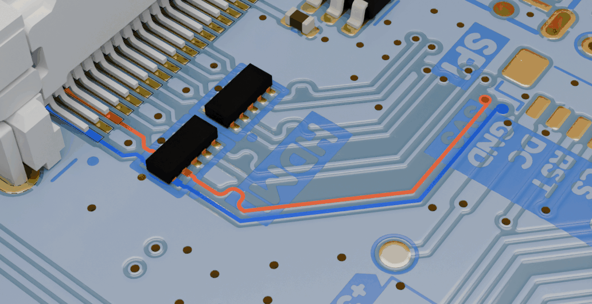
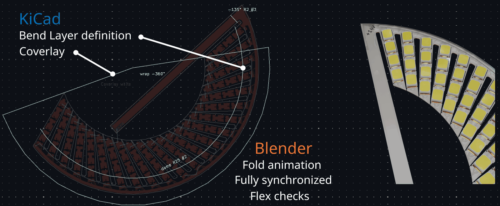

# Gallery

More pictures of KiLeidoscope at work.

  

A differential pair selected in KiCad, with and without X-ray mode.
Board: <a href="https://github.com/piecol/CM5_MINIMA_REV3">CM5 MINIMA REV3</a> by Pierluigi Colangeli (CERN-OHL-S v2).

  

Flex mode: a flex LED ring, flat in KiCad with its marks on the Bend layer, folding in Blender. See the <a href="flex.md">flex guide</a>.

