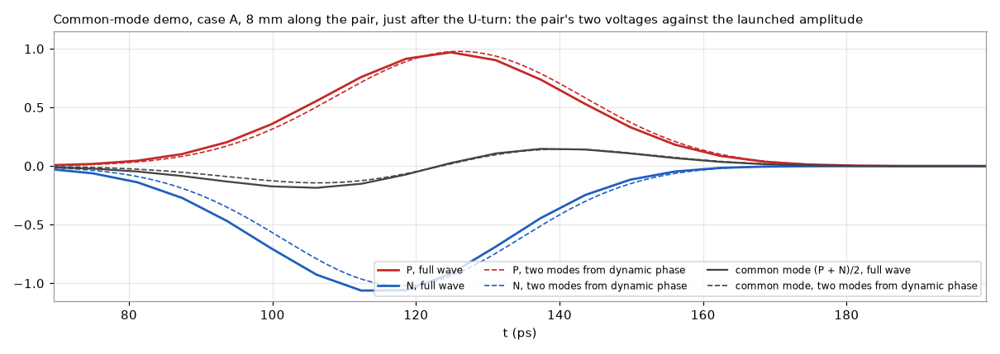

# Dynamic phase

KiCad 10 matches a differential pair by its total delay, end to end. A pair can match there and still run out of phase in between. For example, a bend near one end that is only compensated at the far end leaves P and N apart in time over everything between. Where they are apart, part of the differential signal turns into common mode, which radiates and picks up noise. Correcting the skew at the far end doesn't undo that.

Dynamic phase shows how far P and N are apart in time **at every point along the pair**, live while you route in KiCad.

<!-- Screenshot: a pair in Blender with the red/blue tint, pulses and an amber excursion marker. -->

## What you see

- **Tint:** P red, N blue, over each trace. The stronger the colour, the further apart P and N are there. Via lands are tinted too.
- **Pulses:** start together at the start end and travel at each trace's own delay, slowed down. The pulse in front is ahead.
- **Via light:** columns in the via barrels, in the colour of the side.
- **Amber markers:** where |Δt| stays above your tolerance for longer than your minimum length.
- **Pink markers:** where P's copper touches N's, a short. A shorted pair has no phase and no numbers. Its pulses run from the start end up to the short and stop there.
- **Cyan markers:** copper that closes a loop with the route, such as an old route left beside a new one. The pair is measured along the shortest path. The loop's copper is listed, and a click selects it in KiCad.
- **Pair list:** every pair with its total delay, end-to-end skew and largest |Δt|, a warning icon when it has an excursion or a loop, and SHORT for a shorted pair.

> [!WARNING]
> The pulses are a timing indicator only. They are not electric or magnetic (E/H) fields, currents or voltages. A pulse reaches each point of a trace at the delay dynamic phase computes for it, slowed down from picoseconds to seconds. Nothing else about it is physical. Its shape, width, brightness, tail and glow are chosen to be easy to see. No field, rise time, reflection, loss, crosstalk or radiation is simulated, and a pulse stopping at a short is not what a signal does there.

The tool measures and shows. It doesn't judge: there are no interface standards or pass/fail, only the two thresholds you set for the markers.

## The Δt chart

**Export chart (SVG)** under the pair list writes one small plot per pair: Δt along the pair, the marker tolerance as a green band, every excursion shaded orange with its peak, and over each plot the pair's ends, its end-to-end skew and its largest |Δt|. All plots share one scale, so the pairs compare at a glance. A source and its compensation read as a plateau: Δt steps up at the bend and only steps back where the compensating bump sits, and the plateau's width is how far apart they are. The numbers go into the SVG's `<metadata>` block and, unless you untick it in the file dialog, into a `.csv` beside it (pair, mm along the pair, Δt in ps).

## From the DRC column

The DRC column's **Dynamic phase** button measures every pair at once and lists what the pair list marks, as findings of their own next to KiCad's DRC: an excursion is a warning with the stretch's copper lit and a label at its start, a short an error, a loop a warning; an unfinished side, a branch, or ends on different parts are info. They get the DRC column's markers on the board, confirm and dismiss, and a click selects the copper in KiCad. The file is `.kileidoscope/<board>.phase.kls-findings.json`, beside the DRC one, and it is a snapshot: press the button again after routing.

## How it is calculated

<picture>
  <source media="(prefers-color-scheme: dark)" srcset="dynamic-phase-dark.svg">
  
</picture>

Green runs in the bridge, orange in the Blender add-on. Each step with its code and what it assumes:

**1. Find pairs** · [`channels.find_channels()`](../../kileido_bridge/channels.py)
Nets are paired by KiCad's differential-pair naming (`_P`/`_N`, `+`/`-`). A 2-pad part joining pair nets on both sides, such as AC-coupling caps, chains them into one channel: `TX_P → C1 → TX_C_P` with `TX_N → C2 → TX_C_N`. Can be turned off with *Through series parts*.
*Assumes:* series parts have exactly two pads. A pair joined to more than two others is not chained.

**2. Copper graph per side** · [`channels.build_graph()`](../../kileido_bridge/channels.py)
Track and arc ends are nodes. An end landing inside another track splits that track there, as KiCad connects a T. Vias and pads are nodes that touching ends connect to; stacked vias and vias in pads are joined.
*Assumes:* two pieces touch when an end lies within half a track width. Zones (pours) don't join the route; they only change its speed (see Delay model).

**3. Matching ends, route** · [`channels.pair_routes()`](../../kileido_bridge/channels.py)
The possible ends are pads with a single connection. Of the parts both sides reach, the two farthest apart over P and N together become the pair's ends, so both sides always end on the same parts. Each side's route is the shortest copper path between them. Any other end (an ESD diode, a second receiver) is a branch: listed and warned about, but not walked.
*Assumes:* a branch's loading and reflections don't count. Where a side has a loop, the shorter path is used without a warning.

**4. Walk and add up delay** · [`phase._walk()`](../../kileido_bridge/phase.py)
Each side is walked from the start end. Every track piece adds its length times the unit delay τ of its layer (see [Delay model](#delay-model)). A via adds its barrel between the two layers it connects, and a pad or series part adds the straight line between where the tracks meet it:

$$t(s) = \sum_{\text{pieces up to } s} \ell_i \, \tau_i$$

*Assumes:* delay doesn't depend on frequency, and there is no loss. A capacitor counts only as the distance across it.

**5. Resample, align P and N** · [`phase._resample()`, `_align()`](../../kileido_bridge/phase.py)
Both sides are sampled evenly along their copper, at most 400 points and at least 0.05 mm apart. Dynamic time warping then matches the two sample sequences by 3D distance, counting only the distance beyond each point's nearest point on the other side. Running side by side costs nothing at any pitch, and where one side meanders, the other side's position waits.
*Assumes:* where P and N split far apart (breakouts to different pins), points are matched only by being near each other, and Δt there means less.

**6. Δt along the pair** · [`phase.analyze()`, `_nearby()`](../../kileido_bridge/phase.py)
Each matched point is projected onto the partner's copper, so the result doesn't depend on the sampling step. Δt is the delay difference gathered from the start up to that point:

$$\Delta t(s) = t_P(s) - t_N(s')$$

with $s'$ the matched point on N. Δt < 0: P's edge is ahead there; Δt > 0: N's is.
*Assumes:* a direction; see [Which end to start from](#which-end-to-start-from).

**7. Excursions** · [`phase.find_excursions()`](../../kileido_bridge/phase.py)
Wherever |Δt| stays above *Marker above (ps)* for at least *Marker longer than (mm)*, a marker at the start of that stretch, with its peak Δt and the [mode lag](#common-mode-and-mode-lag) over it. Defaults: 1 ps over 5 mm.

**8. Live: changed pairs only** · [`phase.PhaseTracker`](../../kileido_bridge/phase.py)
A pair is recomputed only when its copper, the delay inputs (stackup, project file, netclasses) or the settings change. Each poll spends at most 80 ms; pairs left over follow on the next polls.

**9. Frames to Blender** · [`phase.pair_frame()`](../../kileido_bridge/phase.py), [`protocol.phase_pair_message()`](../../kileido_bridge/protocol.py)
For each side: its path, and at every point the delay from the start, the lead over the partner and the track width. Plus via lands, both ends, excursions, branches, delay sources and warnings. Blender draws them in [`blender_addon/kileido/phase.py`](../../blender_addon/kileido/phase.py).

## Delay model

The unit delay τ (ps/mm) of each piece comes from [`delays.py`](../../kileido_bridge/delays.py). The first source that applies wins, and the pair list names which one was used.

| Source | Unit delay | Used when |
|---|---|---|
| KiCad tuning profile | the profile's ps/mm for that layer, taken as the pair's at the entry's own width and gap; where the pair runs at another gap, one side alone, or beside a pour, scaled by the estimate's εeff ratio (below); vias by override, or ps/mm × height | the net's netclass has a tuning profile (Board Setup › Tuning Profiles) |
| Microstrip estimate | $\tau = \sqrt{\varepsilon_\text{eff}}\,/\,c$, with $\varepsilon_\text{eff}$ of the coupled pair at the gap there | outer layers, with εr from the board's stackup |
| Stripline estimate | $\tau = \sqrt{\varepsilon_r}\,/\,c$ | inner layers, with εr from the board's stackup |
| FR-4 default | εr = 4.2 in the formulas above | the stackup gives no dielectric constant |

Here $1/c$ = 3.3356 ps/mm. For microstrip, with $u = w/h$ (track width over the dielectric thickness to the next copper layer) and $g = s/h$ (the gap to the partner, edge to edge, measured every 50 µm along the route):

- a lone trace has Hammerstad and Jensen's static $\varepsilon_\text{eff}(u)$;
- in a coupled pair the differential signal runs in the odd mode, with more of its field in the air between the two traces: Kirschning and Jansen's odd-mode $\varepsilon_\text{eff}(u, g)$, which is lower and tends to the lone trace's as $g$ grows. So a stretch where one side meanders away or breaks out runs at the lone trace's speed.

On this project's MIPI pair (117 µm wide, 102 µm apart, 121 µm of εr 4.5) that gives 5.70 ps/mm, against 5.79 from KiCad's calculator (a lone trace: 5.99).

With a tuning profile the profile's number is kept as the level and the estimate only supplies the change: KiCad's calculator worked the entry's delay out for the pair at the entry's width and gap, so that is where it holds exactly, and a stretch where P and N part is multiplied by $\sqrt{\varepsilon_\text{eff}(\text{gap there}) / \varepsilon_\text{eff}(\text{profile gap})}$. KiCad itself charges the one number to every track, which is why its pair tuning works only on coupled stretches and its docs send you to the single-track tuner for the rest; here the two agree wherever the pair runs at the profile's gap, and a lone bump reads a few percent slower, as it is.

Beside a pour of another net on the same layer (a grounded coplanar waveguide), the trace runs faster again. A conformal mapping of the cross-section (Ghione and Naldi's method, with the pair's midline as an electric wall for the odd mode) gives $\varepsilon_\text{eff}$ with and without the pour; that ratio scales the value above. Against a 2D field solver it is within 1.5 %; a pour a quarter of a dielectric height away makes the MIPI pair about 3 % faster.

For stripline the field is entirely in the dielectric, so $\varepsilon_\text{eff} = \varepsilon_r$ whatever the width; different dielectrics above and below are averaged by thickness. A via barrel is $\sqrt{\varepsilon_r}/c$ times the height between the two layers it connects, with εr of the dielectrics it passes.

### Common mode and mode lag

A coupled pair carries two modes: the odd (differential) mode, whose field sits partly in the air between the traces, and the even (common) mode. On microstrip the even mode's effective permittivity is the higher, so it is the slower; in a homogeneous dielectric (stripline) the two travel at the same speed. Kirschning and Jansen's static even mode, with $u = w/h$ and $g = s/h$:

$$v = u\,\frac{20 + g^2}{10 + g^2} + g\,e^{-g}, \qquad \varepsilon_\text{eff,e} = \frac{\varepsilon_r + 1}{2} + \frac{\varepsilon_r - 1}{2}\left(1 + \frac{10}{v}\right)^{-a(v)\,b(\varepsilon_r)}$$

with $a$ and $b$ Hammerstad and Jensen's functions of the lone line, so that a pair far apart ($g \to \infty$, $v \to u$) has both modes become the lone line. The odd mode is the one in the delay model above. Each mode's unit delay is $\tau = \sqrt{\varepsilon_\text{eff}}\,/\,c$, and the mode lag per mm is

$$\tau_\text{e} - \tau_\text{o} = \frac{\sqrt{\varepsilon_\text{eff,e}} - \sqrt{\varepsilon_\text{eff,o}}}{c}.$$

Skew turns differential signal into common mode. With P behind N by a small $\delta$, $V_P(t) = v(t - \delta)$ and $V_N(t) = -v(t)$, so to first order

$$V_\text{diff} = \frac{V_P - V_N}{2} \approx v\!\left(t - \tfrac{\delta}{2}\right), \qquad V_\text{cm} = \frac{V_P + V_N}{2} \approx -\frac{\delta}{2}\,\frac{dv}{dt}$$

a common-mode pulse shaped like the edge's derivative, of order $\delta / t_r$ of the differential amplitude for a rise time $t_r$. A compensating bump $L$ mm further on makes the opposite pulse, aligned with the differential edge as it is then; the first one has fallen behind by $(\tau_\text{e} - \tau_\text{o})\,L$, and the two cancel only while that lag is small against $t_r$. That is the mode lag dynamic phase reports for each excursion (the lag per mm at the gap there, added up along both sides of the stretch; 0 where a side runs alone and on stripline): compare it with your edge's rise time. On the common-mode demo's pair (0.2 mm traces, 0.25 mm apart, 0.12 mm over εr 4.1) the lag is about 0.33 ps/mm, so a fix 45 mm away (case A) comes 15 ps late for a 25 ps edge and leaves two common-mode pulses, while a fix 2 mm away (case B) cancels; a full-wave run gives a common-mode peak at J1 of 32 % of the differential one for A against 14 % for B. With a tuning profile the lag is in the profile's scale, as the delay is. Beside a pour the odd mode's ratio is applied to both modes; the pour's own effect on the even mode is not modelled.

### The equations behind it

Everything above follows from one standard result. For a symmetric coupled pair that is lossless, uniform along its length $z$ and terminated in its modal impedances (no reflections), the coupled telegrapher's equations separate into two modes that never exchange energy, the even (common) and the odd (differential), each with its own velocity $v = 1/\tau$, $\tau = \sqrt{\varepsilon_\text{eff}}/c$ (Tripathi 1975 for the general inhomogeneous case; Pozar, coupled lines, for the symmetric one). Whatever the two conductors carry at $z = 0$ arrives at $z$ as

$$V_P(z,t) = e\!\left(t - \tau_\text{e} z\right) + o\!\left(t - \tau_\text{o} z\right), \qquad V_N(z,t) = e\!\left(t - \tau_\text{e} z\right) - o\!\left(t - \tau_\text{o} z\right),$$

with $e(t) = \tfrac12\,[V_P(0,t) + V_N(0,t)]$ and $o(t) = \tfrac12\,[V_P(0,t) - V_N(0,t)]$. This is exact under those assumptions; the rest is algebra on it.

**Far-end crosstalk is the same velocity difference.** A step $s(t)$ on P with N quiet gives $e = o = s/2$, so at the far end of $\ell$ mm

$$V_N(\ell,t) = \tfrac12\,[\,s(t - \tau_\text{e}\ell) - s(t - \tau_\text{o}\ell)\,] \approx -\tfrac{\ell}{2}\,(\tau_\text{e} - \tau_\text{o})\,s'(t - \tau_\text{o}\ell),$$

the textbook far-end crosstalk of microstrip, zero on stripline where $\tau_\text{e} = \tau_\text{o}$ (Hall and Heck; Johnson and Graham). The mode lag dynamic phase reports is $\ell\,(\tau_\text{e} - \tau_\text{o})$, the same quantity.

**Skew is mode conversion.** P behind N by $\delta$ at $z = 0$, $V_P = s(t - \delta)$ and $V_N = -s(t)$, gives

$$e(t) = \tfrac12\,[\,s(t - \delta) - s(t)\,] = -\tfrac{\delta}{2}\,s'\!\left(t - \tfrac{\delta}{2}\right) + O(\delta^3), \qquad o(t) = \tfrac12\,[\,s(t - \delta) + s(t)\,] = s\!\left(t - \tfrac{\delta}{2}\right) + O(\delta^2).$$

In Bockelman and Eisenstadt's mixed-mode parameters the same statement in the frequency domain is $S_\text{cd21} = \tfrac12\,(S_{21,P} - S_{21,N}) = \tfrac12\,e^{-j\omega T}\,(e^{-j\omega\delta} - 1)$ for two lines of delay $T$ and $T + \delta$, so

$$|S_\text{cd21}| = |\sin(\pi f \delta)|,$$

with its first peak at $f = 1/(2\delta)$: the measure channel standards use for intra-pair skew.

**Why a distant fix does not undo it.** After $\ell$ mm coupled, the common-mode pulse is at $t = \tau_\text{e}\ell$ while the differential edge is at $\tau_\text{o}\ell$: behind by $\Delta\tau = \ell\,(\tau_\text{e} - \tau_\text{o})$, the mode lag. A bump there that delays N by $\delta$ converts again, with the opposite sign and aligned with the edge as it is then, so the common mode that remains is

$$e_\text{left}(t) = \tfrac{\delta}{2}\,\big[\,s'(t - \tau_\text{o}\ell - \tfrac{\delta}{2}) - s'(t - \tau_\text{e}\ell - \tfrac{\delta}{2})\,\big] \approx -\tfrac{\delta}{2}\,\Delta\tau\;s''\!\left(t - \tau_\text{o}\ell - \tfrac{\delta}{2}\right)$$

for $\Delta\tau$ small against the edge's rise time $t_r$. Its size next to the differential signal is then of order $\delta\,\Delta\tau / t_r^2$, within a factor of a few that depends on the edge's shape; once $\Delta\tau$ exceeds the edge the two pulses no longer overlap and what is left is simply the whole common mode, twice over. On the demo's case A, $\delta$ = 8 ps, $\Delta\tau$ = 15 ps and $t_r$ ≈ 25 ps: the order-of-magnitude form gives 0.2, the exact expression for a Gaussian pulse of that rise time 0.44, and the full-wave run gives 0.32 (the common-mode peak over the differential peak at J1's ports), so the three agree within a factor of two. Case B, $\Delta\tau$ under 1 ps, gives 0.02; the 0.14 measured there has other sources (the turn's own change of coupling, the bumps' lone stretches, the serpentine), so the estimate is only a floor. One run each.

### Why Δt holds up when the estimate is off

Δt is a difference between P and N. Where both run on the same layer at the same width, they get the same τ, so an error in τ doesn't create Δt; it only scales it. An εeff that is 5 % off makes τ about 2.5 % off, so a 2 ps excursion reads 1.95 or 2.05 ps. The absolute delays of P and N carry the full error; Δt mostly doesn't.

Δt does go wrong where P and N really differ at the same place in a way the model doesn't see. The next section lists those cases.

## Assumptions and what isn't modelled

- **No frequency dependence.** One εr per dielectric, as the stackup gives it. No change of Dk with frequency, no microstrip dispersion, no loss, no skin effect. These affect P and N alike where they run together.
- **Microstrip:** no solder mask (delay a few % too low), zero copper thickness, and the next copper layer is assumed to be the reference plane.
- **No plane underneath** (a plain coplanar waveguide, a 2-layer board without a pour on the other side, a plane several layers down) is not detected: a whole plane on the next copper layer is always assumed. Finding out what really lies under each trace is a field solver's job; a tuning profile with your own numbers covers such a board.
- **Coupling** is modelled on outer layers: from the gap, by the estimate; with a tuning profile, the profile's number at its own gap scaled by that estimate's ratio (see above). On inner layers (stripline) coupling doesn't change the speed.
- **Meander self-coupling,** which shortens a tight meander's real delay, is not modelled.
- **Grounded coplanar waveguide** is modelled on outer layers without a tuning profile: at each point, the distance to the nearest pour of another net on the same layer speeds that stretch up (a pour past 10 dielectric heights changes nothing). The pour is taken as one straight edge at that distance; stitching vias and the pour's own width are not considered.
- **Vias** are treated as a piece of line. Pad and antipad capacitance and the via stub are ignored.
- **Branches** (ESD stubs, second receivers) are shown but their loading isn't modelled.
- **Glass-weave skew** (one trace over glass, the other over resin) can't be predicted from the layout.

## When not to trust it

- P and N with a plane edge (a split) under them, or no plane under them at all: a whole plane on the next copper layer is assumed.
- Long stretches where P and N run far apart; Δt there is defined only by which points are nearest.
- Unfinished routes: the pair list warns when a side isn't fully routed.
- Pairs whose sides still end on different parts: the pair list warns.
- Delays from "FR-4 default": set εr in the stackup, or a tuning profile, for real numbers.

## Which end to start from

Δt is gathered from the start end. Walked from the other end, it becomes

$$\Delta t'(s) = \text{skew} - \Delta t(s)$$

with skew the total delay difference of the pair. The two views are the same only when total skew is 0. Start from the driver: *Flip start* in the pair list walks a pair from its other end. For a pair driven from both ends (USB, for example) both views matter.

## Validation

The synthetic boards in [`tests/phase_boards.py`](../../tests/phase_boards.py) are checked in [`tests/test_phase.py`](../../tests/test_phase.py), and drawn headless in Blender by [`tests/blender/run_phase.py`](../../tests/blender/run_phase.py).

| Board | What the test checks |
|---|---|
| Matched pair | no skew, no Δt, no excursions; delay = length × τ |
| Mismatch compensated at the far end | an excursion is found although total skew is 0 |
| Mismatch compensated close by | no excursion |
| Layer change through vias | each barrel adds its height between the two layers |
| AC-coupling caps | both pairs join into one channel; length includes the hop across each cap |
| ESD diode on stubs | the stub is a branch, not an end; the route length excludes it |
| Second receiver on stubs | P and N both end on U1 and J1, even where N alone would pick the receiver |
| Flipped start | Δt from the other end equals total skew − Δt |
| Unfinished route | reported |
| Arcs | count their true length, not their chords |
| Tuning profile | the pair at the profile's own gap reads the profile's number exactly; a lone bump on one side runs slower; a single-ended entry and an inner layer are not scaled |
| Lone trace, full wave | one trace of the coupled test pair (0.2 mm wide, 0.25 mm gap, 0.12 mm over εr 4.1) alone, in a 3D FDTD run (openEMS, not part of the repository): 5.876 ps/mm against the estimate's 5.865 (0.2 %); its ratio to the coupled pair 1.0316 against the estimate's 1.0311, which is the ratio the profile scaling uses. Single mesh, 8 cells per dielectric height; the same mesh put the pair within 0.1 % of a finer one |
| Findings file | an excursion, a short, a loop, a branch and an unfinished side become findings the findings reader takes whole, every target found on the board |
| Chart | every pair on one scale, the excursions shaded, the numbers in the SVG and the CSV |
| No εr in the stackup | FR-4 is used and named as the source |
| Microstrip vs stripline | microstrip is faster |
| Coupled pair, and one beside a pour | within 1.5 % of a 2D field solver ([`tests/field_solver.py`](../../tests/field_solver.py)), which itself matches Kirschning and Jansen and Hammerstad and Jensen within 0.4 % |
| The two traces' signals | from the model's skew, odd-mode delays and mode lag, the two voltages along the pair rebuilt with the modal solution above (every step a delay or a half-sum, done in the frequency domain) and compared with the full-wave run's probes on the demo's case A. Just after the U-turn they lie on each other, the common-mode doublet included (figure below), the full-wave common mode 1.3 times larger than the turn's centreline skew of 8.3 ps makes it; the demo's bumps convert by the same factor 1.3 over their own skew. The extra is the discontinuity itself, which reflects differently on the two traces, and it is not in a delay model. Along the straight coupled stretch that follows, the full-wave common mode also creeps up, by a tenth over 10 mm after the turn alone and by a third over the 20 mm before case A's serpentine, which a uniform coupled line cannot do. Both are left out of the model on purpose, and together they are why a probe's centroid on each trace drifts along that stretch in the full-wave run while the model's reading of the same probe does not |
| Even mode and mode lag | the even mode is slower than the odd mode on an outer layer, equal inside, the lone line's far apart and a line twice as wide for touching traces; the far-compensated board's excursion carries a lag proportional to its length (about 6 ps over 45 mm at the 1 mm pitch), the locally compensated one under a tenth of that, a stripline pair none. Against the field solver with a magnetic wall at the pair's midline (run on 2026-10-16, not in the repository) Kirschning and Jansen's even mode is within 1 % on the demo pair, the MIPI pair and the test boards' pair; the lag per mm, a difference of two roots, reads 1 to 10 % above the solver's (demo pair 0.33 against 0.30 ps/mm). In the full-wave run of the demo's case A the common and differential pulses, taken as the half-sum and half-difference of the probes side by side, run at 6.04 and 5.83 ps/mm along the straight stretch after the turn: a lag of 0.21 ps/mm, two thirds of the model's, on a finite board with its plane 3 mm beyond the copper and a mesh of three cells per dielectric height (one run, no finer mesh tried) |
| Stackup from the board file | εr is read from the `.kicad_pcb` text |
| Live tracker | recomputes only changed pairs, spreads work over polls, follows Blender's settings |

**Still to do:** compare the end-to-end P and N delays with KiCad's own time-domain tuning on a real board with a tuning profile. They should match wherever the pair runs at the profile's gap, and differ by the lone stretches' few percent elsewhere.

## References

- M. Kirschning and R. H. Jansen, "Accurate wide-range design equations for the frequency-dependent characteristic of parallel coupled microstrip lines," IEEE Transactions on Microwave Theory and Techniques, vol. 32, no. 1, pp. 83–90, 1984: the even and odd modes.
- E. Hammerstad and Ø. Jensen, "Accurate models for microstrip computer-aided design," IEEE MTT-S International Microwave Symposium Digest, 1980, pp. 407–409: the lone line.
- G. Ghione and C. Naldi, "Coplanar waveguides for MMIC applications: effect of upper shielding, conductor backing, finite-extent ground planes, and line-to-line coupling," IEEE Transactions on Microwave Theory and Techniques, vol. 35, no. 3, pp. 260–267, 1987: the pour beside the pair.
- D. M. Pozar, Microwave Engineering, 4th ed., Wiley, 2012: coupled lines, even and odd modes.
- S. H. Hall and H. L. Heck, Advanced Signal Integrity for High-Speed Digital Designs, Wiley, 2009: modal decomposition, the two mode velocities and far-end crosstalk, differential-to-common conversion.
- E. Bogatin, Signal and Power Integrity — Simplified, 3rd ed., Pearson, 2018: differential pairs, skew and common mode.
- V. K. Tripathi, "Asymmetric coupled transmission lines in an inhomogeneous medium," IEEE Transactions on Microwave Theory and Techniques, vol. 23, no. 9, pp. 734–739, 1975: the two modes of a coupled line with two velocities, the solution the equations above rest on.
- D. E. Bockelman and W. R. Eisenstadt, "Combined differential and common-mode scattering parameters: theory and simulation," IEEE Transactions on Microwave Theory and Techniques, vol. 43, no. 7, pp. 1530–1539, 1995: mixed-mode S-parameters, $S_\text{cd21}$.
- H. W. Johnson and M. Graham, High-Speed Digital Design: A Handbook of Black Magic, Prentice Hall, 1993: far-end crosstalk from the modal velocity difference.

## Code

| File | Contents |
|---|---|
| [`kileido_bridge/channels.py`](../../kileido_bridge/channels.py) | pairs, channels through series parts, copper graph, ends and routes |
| [`kileido_bridge/delays.py`](../../kileido_bridge/delays.py) | delay model: tuning profiles, microstrip, stripline, vias |
| [`kileido_bridge/phase.py`](../../kileido_bridge/phase.py) | walk, alignment, Δt, excursions, live tracker, frames |
| [`kileido_bridge/phase_findings.py`](../../kileido_bridge/phase_findings.py) | the DRC column's Dynamic phase button: every pair as a findings file |
| [`blender_addon/kileido/phase_chart.py`](../../blender_addon/kileido/phase_chart.py) | the Δt chart: SVG and CSV |
| [`blender_addon/kileido/phase.py`](../../blender_addon/kileido/phase.py) | drawing: tint, pulses, glow, via light, markers, labels |
| [`blender_addon/kileido/high_speed_panel.py`](../../blender_addon/kileido/high_speed_panel.py) | the High speed column: Dynamic phase settings and pair list |
