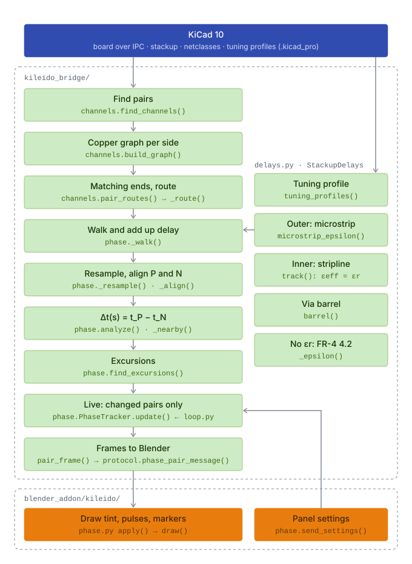

# Dynamic phase

KiCad 10 matches a differential pair by its total delay, end to end. A pair can match there and still run out of phase in between. For example, a bend near one end that is only compensated at the far end leaves P and N apart in time over everything between. Where they are apart, part of the differential signal turns into common mode, which radiates and picks up noise. Correcting the skew at the far end doesn't undo that.

Dynamic phase shows how far P and N are apart in time **at every point along the pair**, live while you route in KiCad.

<!-- Screenshot: a pair in Blender with the red/blue tint, pulses and an amber excursion marker. -->

## What you see

- **Tint:** P red, N blue, over each trace. The stronger the colour, the further apart P and N are there. Via lands are tinted too.
- **Pulses:** start together at the start end and travel at each trace's own delay, slowed down. The pulse in front is ahead.
- **Via light:** columns in the via barrels, in the colour of the side.
- **Amber markers:** where |Δt| stays above your tolerance for longer than your minimum length.
- **Pair list:** every pair with its total delay, end-to-end skew and largest |Δt|, and a warning icon when it has an excursion.

The tool measures and shows. It doesn't judge: there are no interface standards or pass/fail, only the two thresholds you set for the markers.

## How it is calculated

<picture>
  <source media="(prefers-color-scheme: dark)" srcset="dynamic-phase-dark.svg">
  
</picture>

Green runs in the bridge, orange in the Blender add-on. Each step with its code and what it assumes:

**1. Find pairs** · [`channels.find_channels()`](../../kileido_bridge/channels.py)
Nets are paired by KiCad's differential-pair naming (`_P`/`_N`, `+`/`-`). A 2-pad part joining pair nets on both sides, such as AC-coupling caps, chains them into one channel: `TX_P → C1 → TX_C_P` with `TX_N → C2 → TX_C_N`. Can be turned off with *Through series parts*.
*Assumes:* series parts have exactly two pads. A pair joined to more than two others is not chained.

**2. Copper graph per side** · [`channels.build_graph()`](../../kileido_bridge/channels.py)
Track and arc ends are nodes. An end landing inside another track splits that track there, as KiCad connects a T. Vias and pads are nodes that touching ends connect to; stacked vias and vias in pads are joined.
*Assumes:* two pieces touch when an end lies within half a track width. Zones (pours) don't join the route; they only change its speed (see Delay model).

**3. Matching ends, route** · [`channels.pair_routes()`](../../kileido_bridge/channels.py)
The possible ends are pads with a single connection. Of the parts both sides reach, the two farthest apart over P and N together become the pair's ends, so both sides always end on the same parts. Each side's route is the shortest copper path between them. Any other end (an ESD diode, a second receiver) is a branch: listed and warned about, but not walked.
*Assumes:* a branch's loading and reflections don't count. Where a side has a loop, the shorter path is used without a warning.

**4. Walk and add up delay** · [`phase._walk()`](../../kileido_bridge/phase.py)
Each side is walked from the start end. Every track piece adds its length times the unit delay τ of its layer (see [Delay model](#delay-model)). A via adds its barrel between the two layers it connects, and a pad or series part adds the straight line between where the tracks meet it:

$$t(s) = \sum_{\text{pieces up to } s} \ell_i \, \tau_i$$

*Assumes:* delay doesn't depend on frequency, and there is no loss. A capacitor counts only as the distance across it.

**5. Resample, align P and N** · [`phase._resample()`, `_align()`](../../kileido_bridge/phase.py)
Both sides are sampled evenly along their copper, at most 400 points and at least 0.05 mm apart. Dynamic time warping then matches the two sample sequences by 3D distance, counting only the distance beyond each point's nearest point on the other side. Running side by side costs nothing at any pitch, and where one side meanders, the other side's position waits.
*Assumes:* where P and N split far apart (breakouts to different pins), points are matched only by being near each other, and Δt there means less.

**6. Δt along the pair** · [`phase.analyze()`, `_nearby()`](../../kileido_bridge/phase.py)
Each matched point is projected onto the partner's copper, so the result doesn't depend on the sampling step. Δt is the delay difference gathered from the start up to that point:

$$\Delta t(s) = t_P(s) - t_N(s')$$

with $s'$ the matched point on N. Δt < 0: P's edge is ahead there; Δt > 0: N's is.
*Assumes:* a direction; see [Which end to start from](#which-end-to-start-from).

**7. Excursions** · [`phase.find_excursions()`](../../kileido_bridge/phase.py)
Wherever |Δt| stays above *Marker above (ps)* for at least *Marker longer than (mm)*, a marker at the start of that stretch, with its peak Δt. Defaults: 1 ps over 5 mm.

**8. Live: changed pairs only** · [`phase.PhaseTracker`](../../kileido_bridge/phase.py)
A pair is recomputed only when its copper, the delay inputs (stackup, project file, netclasses) or the settings change. Each poll spends at most 80 ms; pairs left over follow on the next polls.

**9. Frames to Blender** · [`phase.pair_frame()`](../../kileido_bridge/phase.py), [`protocol.phase_pair_message()`](../../kileido_bridge/protocol.py)
For each side: its path, and at every point the delay from the start, the lead over the partner and the track width. Plus via lands, both ends, excursions, branches, delay sources and warnings. Blender draws them in [`blender_addon/kileido/phase.py`](../../blender_addon/kileido/phase.py).

## Delay model

The unit delay τ (ps/mm) of each piece comes from [`delays.py`](../../kileido_bridge/delays.py). The first source that applies wins, and the pair list names which one was used.

| Source | Unit delay | Used when |
|---|---|---|
| KiCad tuning profile | the profile's ps/mm for that layer; vias by override, or ps/mm × height | the net's netclass has a tuning profile (Board Setup › Tuning Profiles) |
| Microstrip estimate | $\tau = \sqrt{\varepsilon_\text{eff}}\,/\,c$, with $\varepsilon_\text{eff}$ of the coupled pair at the gap there | outer layers, with εr from the board's stackup |
| Stripline estimate | $\tau = \sqrt{\varepsilon_r}\,/\,c$ | inner layers, with εr from the board's stackup |
| FR-4 default | εr = 4.2 in the formulas above | the stackup gives no dielectric constant |

Here $1/c$ = 3.3356 ps/mm. For microstrip, with $u = w/h$ (track width over the dielectric thickness to the next copper layer) and $g = s/h$ (the gap to the partner, edge to edge, measured every 50 µm along the route):

- a lone trace has Hammerstad and Jensen's static $\varepsilon_\text{eff}(u)$;
- in a coupled pair the differential signal runs in the odd mode, with more of its field in the air between the two traces: Kirschning and Jansen's odd-mode $\varepsilon_\text{eff}(u, g)$, which is lower and tends to the lone trace's as $g$ grows. So a stretch where one side meanders away or breaks out runs at the lone trace's speed.

On this project's MIPI pair (117 µm wide, 102 µm apart, 121 µm of εr 4.5) that gives 5.70 ps/mm, against 5.79 from KiCad's calculator (a lone trace: 5.99).

Beside a pour of another net on the same layer (a grounded coplanar waveguide), the trace runs faster again. A conformal mapping of the cross-section (Ghione and Naldi's method, with the pair's midline as an electric wall for the odd mode) gives $\varepsilon_\text{eff}$ with and without the pour; that ratio scales the value above. Against a 2D field solver it is within 1.5 %; a pour a quarter of a dielectric height away makes the MIPI pair about 3 % faster.

For stripline the field is entirely in the dielectric, so $\varepsilon_\text{eff} = \varepsilon_r$ whatever the width; different dielectrics above and below are averaged by thickness. A via barrel is $\sqrt{\varepsilon_r}/c$ times the height between the two layers it connects, with εr of the dielectrics it passes.

### Why Δt holds up when the estimate is off

Δt is a difference between P and N. Where both run on the same layer at the same width, they get the same τ, so an error in τ doesn't create Δt; it only scales it. An εeff that is 5 % off makes τ about 2.5 % off, so a 2 ps excursion reads 1.95 or 2.05 ps. The absolute delays of P and N carry the full error; Δt mostly doesn't.

Δt does go wrong where P and N really differ at the same place in a way the model doesn't see. The next section lists those cases.

## Assumptions and what isn't modelled

- **No frequency dependence.** One εr per dielectric, as the stackup gives it. No change of Dk with frequency, no microstrip dispersion, no loss, no skin effect. These affect P and N alike where they run together.
- **Microstrip:** no solder mask (delay a few % too low), zero copper thickness, and the next copper layer is assumed to be the reference plane.
- **No plane underneath** (a plain coplanar waveguide, a 2-layer board without a pour on the other side, a plane several layers down) is not detected: a whole plane on the next copper layer is always assumed. Finding out what really lies under each trace is a field solver's job; a tuning profile with your own numbers covers such a board.
- **Coupling** is modelled on outer layers without a tuning profile (see above). A tuning profile gives one value per layer, coupled or not, as KiCad's own tuning does. On inner layers (stripline) coupling doesn't change the speed.
- **Meander self-coupling,** which shortens a tight meander's real delay, is not modelled.
- **Grounded coplanar waveguide** is modelled on outer layers without a tuning profile: at each point, the distance to the nearest pour of another net on the same layer speeds that stretch up (a pour past 10 dielectric heights changes nothing). The pour is taken as one straight edge at that distance; stitching vias and the pour's own width are not considered.
- **Vias** are treated as a piece of line. Pad and antipad capacitance and the via stub are ignored.
- **Branches** (ESD stubs, second receivers) are shown but their loading isn't modelled.
- **Glass-weave skew** (one trace over glass, the other over resin) can't be predicted from the layout.

## When not to trust it

- P and N with a plane edge (a split) under them, or no plane under them at all: a whole plane on the next copper layer is assumed.
- Long stretches where P and N run far apart; Δt there is defined only by which points are nearest.
- Unfinished routes: the pair list warns when a side isn't fully routed.
- Pairs whose sides still end on different parts: the pair list warns.
- Delays from "FR-4 default": set εr in the stackup, or a tuning profile, for real numbers.

## Which end to start from

Δt is gathered from the start end. Walked from the other end, it becomes

$$\Delta t'(s) = \text{skew} - \Delta t(s)$$

with skew the total delay difference of the pair. The two views are the same only when total skew is 0. Start from the driver: *Flip start* in the pair list walks a pair from its other end. For a pair driven from both ends (USB, for example) both views matter.

## Validation

The synthetic boards in [`tests/phase_boards.py`](../../tests/phase_boards.py) are checked in [`tests/test_phase.py`](../../tests/test_phase.py), and drawn headless in Blender by [`tests/blender/run_phase.py`](../../tests/blender/run_phase.py).

| Board | What the test checks |
|---|---|
| Matched pair | no skew, no Δt, no excursions; delay = length × τ |
| Mismatch compensated at the far end | an excursion is found although total skew is 0 |
| Mismatch compensated close by | no excursion |
| Layer change through vias | each barrel adds its height between the two layers |
| AC-coupling caps | both pairs join into one channel; length includes the hop across each cap |
| ESD diode on stubs | the stub is a branch, not an end; the route length excludes it |
| Second receiver on stubs | P and N both end on U1 and J1, even where N alone would pick the receiver |
| Flipped start | Δt from the other end equals total skew − Δt |
| Unfinished route | reported |
| Arcs | count their true length, not their chords |
| Tuning profile | sets the delay before any estimate |
| No εr in the stackup | FR-4 is used and named as the source |
| Microstrip vs stripline | microstrip is faster |
| Coupled pair, and one beside a pour | within 1.5 % of a 2D field solver ([`tests/field_solver.py`](../../tests/field_solver.py)), which itself matches Kirschning and Jansen and Hammerstad and Jensen within 0.4 % |
| Stackup from the board file | εr is read from the `.kicad_pcb` text |
| Live tracker | recomputes only changed pairs, spreads work over polls, follows Blender's settings |

**Still to do:** compare the end-to-end P and N delays with KiCad's own time-domain tuning on a real board with a tuning profile. They should match.

## Code

| File | Contents |
|---|---|
| [`kileido_bridge/channels.py`](../../kileido_bridge/channels.py) | pairs, channels through series parts, copper graph, ends and routes |
| [`kileido_bridge/delays.py`](../../kileido_bridge/delays.py) | delay model: tuning profiles, microstrip, stripline, vias |
| [`kileido_bridge/phase.py`](../../kileido_bridge/phase.py) | walk, alignment, Δt, excursions, live tracker, frames |
| [`blender_addon/kileido/phase.py`](../../blender_addon/kileido/phase.py) | drawing: tint, pulses, glow, via light, markers, labels |
| [`blender_addon/kileido/high_speed_panel.py`](../../blender_addon/kileido/high_speed_panel.py) | the High speed column: Dynamic phase settings and pair list |
