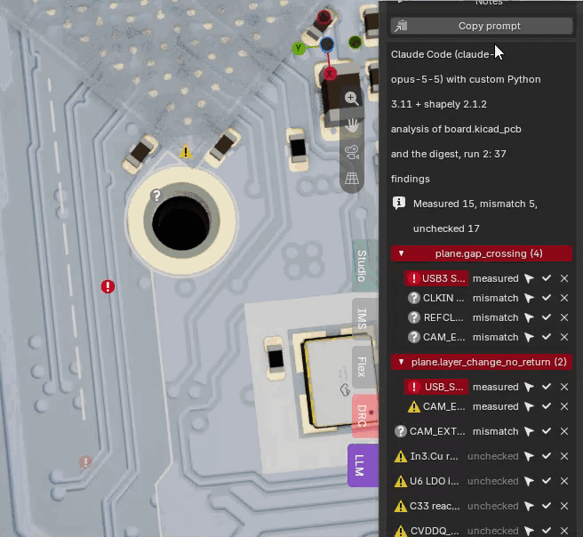
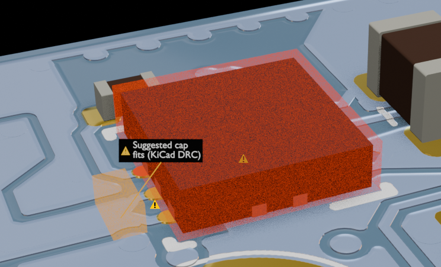
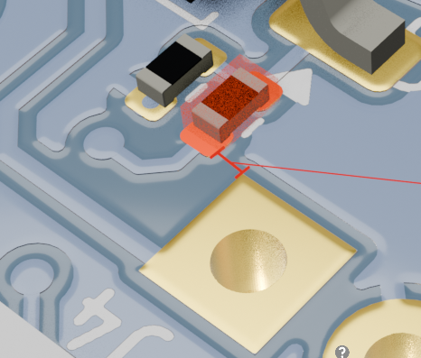
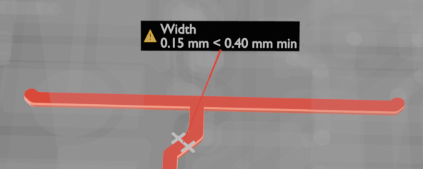
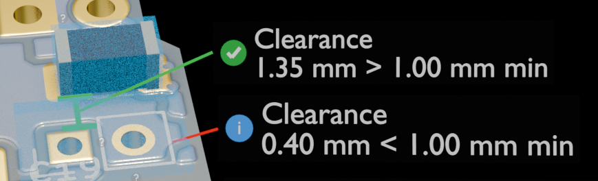

<!-- Guide for 0.5.1. -->

# (New!) LLM review visualizer on the 3D board

No, this is not yet another AI plugin. It's a tool for visualizing your AI board checking tools. This tool is designed to tackle one of the largest frustrations in PCB design; the lengthy review process. While LLMs are now very capable of checking your boards with some great specialized KiCad based plugins, the output of these tools remains text-based. Because your PCBs are 3D structures, it is up to the user to translate from text to the 3D world, which can quickly become fatiguing when dealing with large, complex boards. The KiLeidoscope LLM-review tab hopes to facilitate this process, by simply introducing a handshake layer between the LLM's textual output and Blender's 3D visualization. Furthermore, the 3D LLM-review double-checks the LLM's suggested fixes with KiCad's DRC, and even visualizes the LLM's suggestions using ghost placements of components or trace re-routing!

The tool works with your favorite LLM, and filters out some of your privacy-sensitive information (the title block with your company and author, board text variables, schematic sheet names and local file paths). LLM-review creates a personalized prompt for you, that allows you to easily paste your review command into your own LLM.

❗ KiLeidoscope itself sends nothing anywhere: no account, no API key, no network. The only copy of your board that leaves your machine is the one your own LLM tool sends, and a local model keeps it at home. KiLeidoscope itself does not run any servers and does not track your data! ❗

  

What a review looks like on the board. Every number in these labels is KiLeidoscope's own measurement; the LLM only said where to look.

<table>
  <tr>
    <td align="center"> 1.00 mm max and 2.59 mm > 1.00 mm max, and two translucent red suggested vias, each labelled Suggested via, fits (KiCad DRC)."> A layer change without a return via: the nearest return vias measured against the 1 mm radius, red past it; the LLM's two suggested vias drawn where it put them, cross-verified by KiCad's DRC.</td>
    <td align="center"> A missing decoupling cap: the suggested cap drawn beside the pin, the size and turn the LLM gave, checked clear of the parts around it.</td>
  </tr>
  <tr>
    <td align="center"> Design for manufacturing check.</td>
    <td align="center"> A power trace too thin for its current: every segment at its width, the thin one red, measured against the width the LLM asks for.</td>
  </tr>
  <tr>
    <td align="center" colspan="2"> 1.00 mm min, and a blue i with Clearance 0.40 mm < 1.00 mm min."> Two clearances the LLM asked for: one meets its limit (green, a tick) and one does not. Measured on the board, whatever the LLM's text says.</td>
  </tr>
</table>

## Contents

- [Before you start](#before-you-start)
- [A review in five steps](#a-review-in-five-steps)
- [The prompt](#the-prompt)
- [What the LLM gets](#what-the-llm-gets)
- [While the LLM works](#while-the-llm-works)
- [The list](#the-list)
- [Verdicts](#verdicts)
- [Showing a finding](#showing-a-finding)
- [What is drawn](#what-is-drawn)
- [Suggestions](#suggestions)
- [Confirm and dismiss](#confirm-and-dismiss)
- [The .kileidoscope folder](#the-kileidoscope-folder)
- [How it works](#how-it-works)
- [Known limitations](#known-limitations)
- [Disclaimer](#disclaimer)

## Before you start

- **A live link.** Open the board in Blender with **Open in Blender** in KiCad's PCB editor. Without it the **LLM** tab is greyed out; a list from earlier stays readable.
- **A saved board.** The prompt, the board copy and the answer live in a folder beside the board file. Save the board once; unsaved edits after that are fine.
- **An LLM tool that can read and write files.** The prompt points the LLM at a folder and asks it to write its answer there, so a chat window is not enough. Agent tools such as Claude Code, Codex, Gemini CLI or an editor assistant with file access all work; so does a local model behind one of them. The LLM may use any KiCad analysis tools it has; KiLeidoscope does not need any.
- **kicad-cli**, which comes with KiCad: KiCad's own DRC runs first so the LLM does not repeat it, and checks the LLM's suggestions afterwards. See the [DRC guide](drc.md#before-you-start) for which kicad-cli is used.

## A review in five steps

1. Open the purple **LLM** tab beside the **KiLeidoscope** tab of the 3D View sidebar (**N**).
2. Tick the checks you want (the default, **Measured**, is a good start) and press **Copy prompt**.
3. Paste the prompt into your LLM tool and let it run. The column shows how far it is.
4. The findings appear in the column as soon as the answer is written. Click one to see it drawn on the board.
5. Confirm what is real, dismiss what is not. Dismissed findings go into the next prompt, so the LLM does not report them again.

## The prompt

The prompt box sits at the top of the LLM column.

**Which checks.** The prompt asks the LLM for a list of named checks, 65 in all, in ten groups: return paths and planes, decoupling, switching regulators, DC and current, high speed, differential pairs, connectors and EMC, analog and clocks, thermal, fabrication. The **Checks** fold lists them by group; a click on a check ticks or unticks it. Three presets:

| Preset | Ticks |
| --- | --- |
| **Quick** | Three checks for a short review: a signal crossing a plane gap, a layer change without a return via, a decoupling cap far from its pin. |
| **Measured** | The 34 checks KiLeidoscope can measure, so every finding gets a verdict from the board. The default. |
| **All** | Every check. A long review: the LLM takes much longer, and the checks nothing measures come back *unchecked*. |

A check KiLeidoscope cannot measure says *unchecked* beside its name in the list.

**Notes.** Under the checks, the **Notes** fold holds three ready-made sentences for the LLM and a line of your own: use the KiCad analysis tools you have; keep it cheap, no sub-agents; report only what you are confident about. Your own line goes last. Together they go into the prompt as plain text, at most eight lines.

**Copy prompt.** The button first runs KiCad's DRC on the board as it is in KiCad now (so the request can tell the LLM what DRC already found), then freezes a copy of the board and writes the request beside it, and puts a short prompt on the clipboard. The button reads *Making prompt…* meanwhile; **Show prompt** shows the text that was copied. Paste it into your LLM tool.

The prompt itself is a few lines: where the request is, which files are in the folder, where to write the answer. The long part, the request, is a file the LLM reads.

## What the LLM gets

Each prompt makes a run folder, `.kileidoscope/runs/<N>/`, with:

| File | What it is |
| --- | --- |
| `request.md` | The rules, the checks to run with what each one should look at, the drawing tools it may use, the answer format, what KiCad's DRC already found, what you dismissed before, and your notes. |
| `board.kls-board.json` | A digest of the board: every part, pad, net, via and track with the exact names the answer must use, the stackup, the zones. No fill polygons. About half a kilobyte per part. |
| `board.kicad_pcb` | The board itself, for detail the digest leaves out. |
| the project and rules files | So the LLM sees your net classes and constraints. |

The copy is the board as KiCad has it at that moment, unsaved edits included, with a few things taken out that name you rather than the design: the title block, board-level text variables, the folder paths of 3D models (the file names stay), and a part's Datasheet field when it points at a local file. Net names, references and values stay; the LLM needs them. The run id and a stamp of the board text go out in the request and must come back in the answer, so an answer to an older run, or to another board, is marked as such.

## While the LLM works

Under **Copy prompt** the column follows the review:

- *Waiting for the LLM… prompt copied 2 min ago* until the LLM starts.
- *Run 12: check 30 of 65 — plane.edge_run*, with a bar and the LLM's own note of what it is doing, if it keeps the small progress file the request asks for (it is optional, to spare tokens).
- *No update for 6 min — the LLM may have stalled or be waiting for your approval* when nothing has changed for a while. Agent tools often stop to ask before writing a file: look at the tool.

How long a review takes depends on the LLM, the tool and the board: a full review with all 65 checks can take a good while, the three quick checks much less. The answer lands in the column the moment the file is written.

## The list

The header names the tool and the run, *Claude Code, run 12: 33 findings*. **About this run** under it holds the tool's full description and the verdict counts, *Measured 15, mismatch 5, unchecked 13*. A file that does not answer a prompt this KiLeidoscope made says so: *Answer to run 9, not one this board's KiLeidoscope made (or the board has changed since)*, or *From my-checker, not from a KiLeidoscope prompt*. Such files are drawn all the same.

The findings are grouped by check, groups with errors first; unchecked findings go last in their group. At most 20 findings of one check are listed, the worst first, and the row *12 more not shown: all in the findings file* counts the rest. Two folded sections close the list: **Not checked**, the checks the LLM skipped with its reason, and **Checked, nothing found**, the checks it ran and found clean. A clean check is a result too.

The filter row above the list works as in the [DRC column](drc.md#markers-on-the-board): **Errors**, **Warnings** and **Info** with their counts, and on this tab **Unchecked**, which hides the findings KiLeidoscope could not measure. **Show dismissed** and **Markers** are the same as there.

Each row has the severity icon, the title (a click shows the finding), the select arrow (selects its items in KiCad), the tick and the cross. The verdict shows in the row's look rather than in a word: see below.

## Verdicts

Every finding gets a verdict from the board as it is now. The verdict is in the row's icon and shade, in the title's tooltip, and spelled out in the first line of the finding's details.

| Verdict | Row | Meaning |
| --- | --- | --- |
| **Measured** | Severity icon | KiLeidoscope found what the finding points at and measured it, and nothing contradicts it. A measured *distance 2.8 mm > 2 mm max* is a real 2.8 mm; whether 2 mm is the right limit is still the LLM's judgement. |
| **Refuted** | Grey "?" | Every limit the finding gave is met on the board: an edge gap of 1.9 mm against a 0.5 mm minimum. The measurement does not support the finding. |
| **Mismatch** | Grey "?" | The board says otherwise: something the finding names is not on the board, a value it claims is far from the one measured (both are shown), a rule its check carries fails (the two pads of a "decoupling pair" are not connected, the "pair" is not a differential pair), or a suggestion does not fit. The details say which. |
| **Unchecked** | Greyed title | Nothing here was measured: the finding only highlights or labels, or its check is one nothing measures yet. The LLM's word only. |

The verdict is about what KiLeidoscope could check, not about whether the LLM is right. A measured finding can still be a non-issue; an unchecked one can be the most important thing on the board. Read it, look at the drawing, decide.

## Showing a finding

A click on a title draws the finding on the board, frames the views on it, selects its items in KiCad and opens its details, as in the [DRC column](drc.md#showing-a-finding). The details hold:

- the verdict line, and any rule the check carries with how it went (*C12 and U3.4 share +3V3*);
- the LLM's message and fix;
- **name chips**: every part, pad, net or via the text names that is on the board, as a button that selects it in KiCad, with what it is (*pad, VIN, +5V*). A uuid the text names that is on no item is listed as not found: a quick sign the LLM made it up;
- *LLM confidence: high | medium | low*, as the LLM gave it;
- the LLM's numbers, marked *(LLM)*: *distance (LLM): 2.8 mm*. When KiLeidoscope measured the same thing and the two are more than 10 % apart, the line turns red and says both: *distance: claimed 1 mm, measured 5.3 mm*;
- a line per drawing: what it measured against its limit, which items it lit, or why it could not be drawn.

A finding with no drawing at all (a board-wide check such as PDN impedance) still gets a place: the parts and pads its text names are highlighted, and the details say *No drawing given: the parts its text names are highlighted*.

Reference-plane findings (the `plane.…` checks) switch on **X-ray mode** while shown, so the plane under the copper is visible, and switch it off again when hidden; untick it yourself if you prefer the full board.

## What is drawn

The LLM does not draw. It names things (`U3.4`, `net:CLK@In1.Cu~42.1,18.75`, `uuid:5a222dbd`) and picks drawing tools from a fixed list; KiLeidoscope finds the items on the live board and draws them with the same shapes as the DRC column: lit items, labels on dark plates, thin dimension lines, arrows. The tools:

| Tool | Drawn | Measured |
| --- | --- | --- |
| `highlight`, `isolate` | The items lit; isolate in X-ray mode. | – |
| `label`, `arrow` | A callout at a target; an arrow between two. | – |
| `lift` | A part copied and tilted up about a point (`about`), its `toward` end rising, as a tombstone; the part itself hidden meanwhile. | – |
| `area` | A translucent region on a layer: a loop, a keep-out. | – |
| `layers` | Only the named copper layers shown while the finding is. Two neighbouring layers: their dielectric from the stackup. | A claimed `distance_mm` |
| `distance` | A dimension between two targets, against a limit (a reach, `max`, or a clearance, `min`). | Yes |
| `clearance` | The closest gap between two items. | Yes |
| `edge_gap` | From the copper to the board outline. | Yes |
| `width` | Every segment of a track as a ribbon at its width, the thin ones red. | Yes |
| `routed_length` | The copper path between two pads lit, with its length (tracks, arcs and vias; not zones). | Yes |
| `bars` | A small bar chart beside a part: bus lengths, rail drops. | The LLM's numbers |
| `layer_change` | A signal via ringed with its nearest return via, measured against a radius. | Yes |
| `plane_gap` | Where a track has no plane under it: the plane's edges lit, the stretches red, the longest gap measured. | Yes |
| `return_path` | A signal's stretches with and without its plane, the length without. | Yes |
| `plane_islands` | Each piece of a plane in its own colour with its area; pieces no via ties to the rest marked. | Yes |
| `stitching` | A net's vias along a pour's edge or the board edge, the widest spacing measured. | Yes |
| `stub` | A via's barrel with its unused part past the last layer its net uses, from the stackup. | Yes |
| `discontinuity` | A marker at each point where a net's width, layer or reference plane changes. | Yes |
| `ghost` | A suggestion: see below. | Checked to fit |

For a track between two planes (a stripline), `plane_gap` and `return_path` also check the plane on the track's other side, and say so with both distances: *In4.Cu GND under all of it, 0.55 mm away (In2.Cu: 0.11 mm)*. The named plane is the one the LLM blamed; the other is there for you to weigh.

## Suggestions

An LLM likes to say what to change. KiLeidoscope draws such a suggestion as a translucent *ghost* where the LLM put it, and checks that it fits:

| Ghost | Drawn | Checked |
| --- | --- | --- |
| A via or a pad | A translucent cylinder or pad at the point. | Clear of other nets' copper; inside the board; within a layer change's radius when it is a return via. |
| A cap | A body the size the LLM gave, turned as it said. | Clear of other parts' pads and bodies on its side; inside the board. |
| A part moved | The part's pads and body at the new place, a thin arrow from where it is now. | Its pads clear of other nets' copper; its body clear of other parts; inside the board. |
| A route | A translucent track through the points, at the net's usual width. | Clear of other nets' copper on its layer; inside the board. |
| A row of vias | Each via of the row, the ones that clash red. | Each via as a single via. |

Two checks run. A quick one in KiLeidoscope, at once. Then KiCad's own DRC: every ghost is written into a copy of the board and `kicad-cli pcb drc` runs on it with your rules, so the verdict is KiCad's. The label says whose: *checking with KiCad DRC…*, then *fits (KiCad DRC)* or *does not fit (KiCad DRC): clearance 0.20 mm needed, 0.12 mm*. Without kicad-cli, the quick check's word stands and the label says *(quick check)*. A suggestion that does not fit makes its finding a mismatch.

KiLeidoscope never changes the board. A ghost is a picture; moving the cap is yours to do in KiCad. If you want a more dynamic approach, simply ask your LLM to update the board after the review round. 

## Confirm and dismiss

The tick and the cross work as in the [DRC column](drc.md#confirm-and-dismiss): a confirmed finding shows a tick, a dismissed one leaves the list and its marker, **Show dismissed** brings it back greyed. The marks follow a finding by its check and the items it names, so they survive a new review.

Dismissed findings do more here: the next prompt lists them under *Dismissed by the user*, by check and title, and asks the LLM not to report them again. The findings of KiCad's own DRC and of the LLM are kept apart: a dismiss in one tab does not touch the other.

## The .kileidoscope folder

Everything lives in `.kileidoscope` beside the board file, the only place KiLeidoscope writes into your project; it holds a `.gitignore` that keeps it out of your repository.

| File | What it is |
| --- | --- |
| `runs/<N>/` | One folder per run: a prompt (`request.md`, the digest, the board copy), a KiCad DRC run, or a DRC run on the ghosts. Run ids count up across all kinds; the last five prompt and DRC runs are kept, and the last two ghost runs. |
| `<board>.kls-findings.json` | The LLM's answer: the findings file. A script of your own can write it too ([DRC guide](drc.md#findings-files-from-a-script)). |
| `<board>.kls-progress.json` | The LLM's progress while it works, if it keeps one. |
| `<board>.drc.kls-findings.json` | KiCad's DRC findings, the DRC tab's. |
| `dismissed.json` | Your confirm and dismiss marks, both tabs. |

Deleting the folder is safe: you lose the marks and the old runs, nothing else.

## How it works

<picture>
  <source media="(prefers-color-scheme: dark)" srcset="../assets/llm-review-dark.svg">
  
</picture>

1. **Copy prompt.** The bridge (inside KiCad's Python) runs KiCad's DRC, freezes the board as KiCad has it into a run folder with the digest and the request, and hands Blender the short prompt for the clipboard.
2. **The LLM.** Your tool reads the request, works from the digest and the board file, and writes `<board>.kls-findings.json` beside the board. The format is `kls-findings 1`, the same file a script can write; the request spells it out.
3. **Resolve.** The bridge reads the file as data (text is text; nothing in it is run), finds every named item on the live board, measures every claim it can, applies the rules of each check, and gives each finding its verdict. Each edit in KiCad repeats this, so the drawing follows the board.
4. **Ghosts.** The bridge writes the suggestions into a copy of the board and runs KiCad's DRC on it in the background; the result replaces the quick check's.
5. **Draw.** Blender lists the findings and draws the one you pick.

## Known limitations

- **The LLM needs file access.** A plain chat cannot write the answer file. Paste the answer into the file by hand if you must; the run id and stamp in it still have to match.
- **Only what is measurable gets a verdict.** 31 of the 65 checks have no measuring tool yet (differential pair geometry, decoupling loops, thermal and copper balance among them); their findings come back unchecked.
- **Track stubs are not measured**, only via stubs. A test-pad branch on a clock is the LLM's to spot and highlight.
- **One drawing at a time**, as in the DRC column. At most 300 findings and 20 per check.
- **The LLM varies.** Two reviews of the same board agree on most findings, not all. Run it twice if a result matters.
- **Cost and time.** A full review reads a large board file; with a paid tool that is real money. Start with **Measured** or **Quick**, and tick *keep it cheap*.
- **Folded flex boards** show no drawing until unfolded.

## Disclaimer

The LLM column shows and checks what an LLM says about your board. The findings are the LLM's; KiLeidoscope adds no review of its own and does not replace a design review, your fabricator's checks or KiCad's DRC.

- **A verdict is not a judgement.** *Measured* means KiLeidoscope found and measured what the finding points at; whether it is a problem is still a question of your design. *Unchecked* means nobody but the LLM says so.
- **A suggestion that fits is not a suggestion that helps.** KiCad's DRC says the ghost via breaks no rule; it does not say the via does what the LLM claims.
- **The board copy leaves your machine only if your LLM tool sends it.** KiLeidoscope strips the title block and local paths; it cannot strip the design. With a board under NDA, use a local model or a tool whose terms you have read.
- **Measurements are an illustration**, taken on KiLeidoscope's copy of the board geometry; for sign-off, KiCad's numbers count.

The [disclaimer](../README.md#disclaimer) and [license](../LICENSE) of KiLeidoscope apply in full: the software comes without any warranty, and you use it at your own risk.
